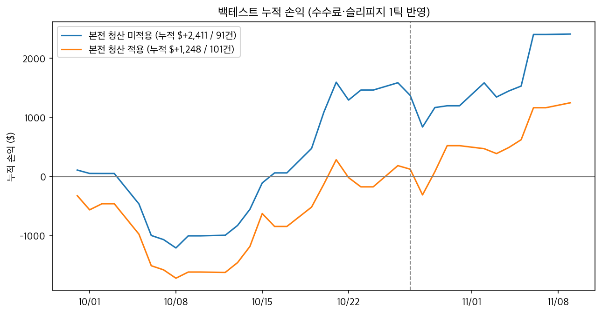
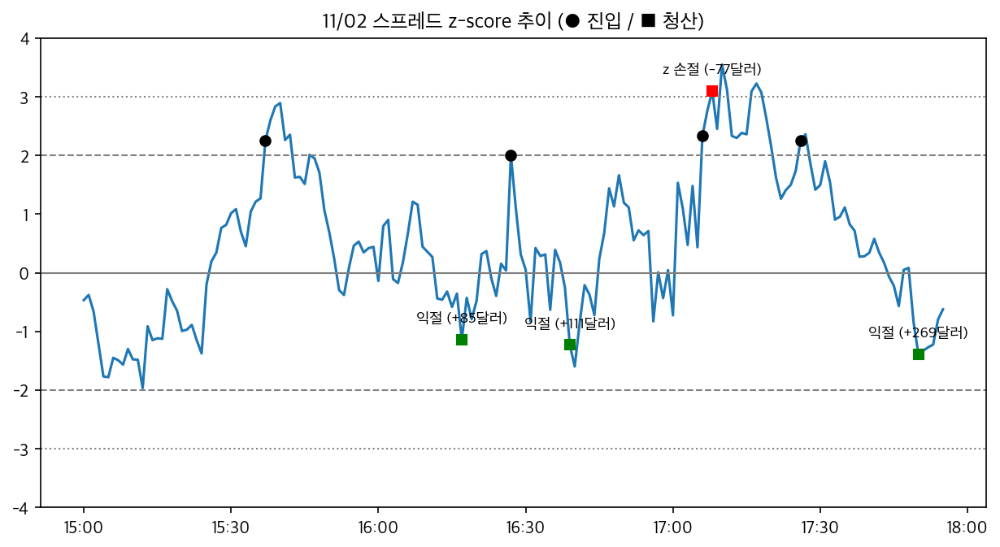
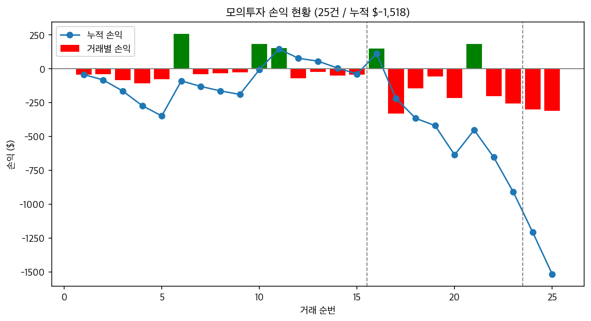

# Week 04. 복수상품 스프레드 전략: MNQ-MGC 가격비율 평균회귀

## 수행 내용

CME 마이크로 나스닥100 선물(MNQ)과 마이크로 금 선물(MGC)의 가격비율이 최근 1시간 평균에서 크게 벗어나면, 상대적으로 오른 상품을 매도하고 내린 상품을 매수하는 전략을 구현했습니다. 가격비율이 평균을 지나 반대쪽까지 움직이면 두 포지션을 함께 청산합니다. 벗어난 정도는 z-score, 즉 현재 가격비율이 최근 평균에서 표준편차 몇 배만큼 떨어져 있는지로 판단합니다. 두 레그를 각각 시장가로 주문하고, 실시간 체결은 WebSocket 하나로 두 종목을 함께 받았습니다.

- 상품: Micro E-mini Nasdaq-100 202612 (`MNQZ26`), Micro Gold 202612 (`MGCZ26`), 거래소 코드 모두 `FCME`
- 전략: 1분봉 가격비율의 z-score 평균회귀, 15:00 ~ 17:55, 하루 최대 4회
- 계약 수: 두 레그의 명목금액이 비슷하도록 MNQ 2계약 : MGC 3계약
- 실행 환경: 모의계좌 주문
- 실행일: 2026-11-10 ~ 11-12 (시운전과 리허설), 2026-11-13 (수익률 대회)
- 실행 결과: 11/10 ~ 11/11 전략 거래 24회 (시험 주문 제외, 청산 로그가 남은 거래 23회). 대회 결과는 [6-2](#6-2-모의계좌-실행)에 정리

## 1. 과제 요약

- 시세 조회
  - 시작할 때 두 종목 과거 1분봉 REST 조회 (`core/market_data.py`)
  - 실행 중 WebSocket `FA` 하나로 두 종목 체결 수신, 1분마다 스프레드 계산 (`stream.py`, `live.py`)
- 진입, 청산 (`strategy.py`, `live.py`)
  - z가 ±2.0에 닿으면 진입, 평균을 지나 반대편 z 1.0에서 익절
  - z 손절, 금액 손절, 시간 손절, 17:55 정리
- 두 레그 주문 (`live.py`)
  - 두 레그 시장가 주문을 차례로 보낸 뒤 체결 확인
  - 한쪽만 체결되면 잔고를 확인하고 1회 재주문, 실패하면 체결된 레그 정리
- 위험 관리
  - 거래당 손실 −$300, 하루 손실 −$600, 하루 최대 4회
  - 손절 뒤 15분 재진입 금지
  - 재시작해도 하루 손익과 진입 횟수를 이어받음
- 실행 기록: `results/`에 실행 로그(`.log`), 이벤트 기록(`.jsonl`), 상태 파일(`.json`), 그래프(`plots/`) 저장
- 결과 분석: [백테스트](#6-1-백테스트), [모의계좌 실행 결과](#6-2-모의계좌-실행), [그래프 노트북](plots.ipynb)

## 2. 실행 방법

```bash
# 저장소 루트에서 실행
# 패키지 설치 후 .env에 API 키 입력
python3 -m pip install -r requirements.txt
cp .env.example .env

# 두 종목 과거 1분봉 저장 (기본 4만 개)
python3 -m week04.fetch_data

# 백테스트: 전체 버전 비교 / 슬리피지 0틱
python3 -m week04.backtest
python3 -m week04.backtest --slippage 0

# 모의계좌 실행: 대회 시간 / 긴 실행
python3 -m week04.live
python3 -m week04.live --session long

# 그래프: plots.ipynb를 열어 전체 실행
```

### 재현 입력값

| 항목 | 값 | 위치 |
| --- | --- | --- |
| 데이터 | `MNQZ26`, `MGCZ26` 1분봉, 모의 서버, 11/10 05시 수집 | `fetch_data.py` |
| 백테스트 기간 | 2026-09-30 ~ 11-09, 35일 | `config.json` `backtest` |
| 비교 / 확인 기간 | 10/27까지 / 10/28부터 | `split_date` |
| 시간 | 진입 15:00 ~ 17:30, 정리 17:55 | `sessions.contest` |
| 체결 가정 | 1분봉 종가로 판단, 다음 분 시가에 체결 | `backtest.py` |
| 비용 | 수수료 계약당 편도 $2, 슬리피지 레그별 1틱 | `fee_per_contract`, `slippage_ticks` |
| 전략 숫자 | 계산 구간 60분(N=60), 진입 z 2.0, 익절 z 1.0, z 손절 3.0, 시간 손절 45분 | `strategy` |
| 위험 한도 | 거래당 $300, 하루 $600, 하루 4회, 재진입 금지 15분 | `strategy` |
| 비교 버전 | 진입 z, 익절 z, z 손절, N, 본전 청산을 하나씩 바꾼 6개 | `versions` |

## 3. 전략과 매매 계획

### 3-1. 전략 선정 배경

**3주차에서 남은 문제**

3주차 MNQ 범위 돌파 전략은 손절 폭 한도에 걸려 본 실행에서 주문이 한 번도 나가지 않았습니다. 백테스트 거래도 두 기간을 합쳐 11건뿐이어서 전략이 맞는지 판단하기 어려웠습니다. 2주차에는 국채선물 가격 움직임에 비해 비용이 커서 손익 방향이 바뀌었습니다.

그래서 4주차에는 다음을 기준으로 전략을 골랐습니다.

- 하루에 여러 번 거래가 나와 분석할 거래를 충분히 확보할 수 있을 것
- 거래 비용을 반영하고도 수익이 날 것
- 2, 3주차의 추세 추종과 다른 평균회귀 전략일 것

**후보 비교**

팀원 후보 5개와 시황을 보고 정한 후보 3개를 같은 백테스트 엔진으로 비교했습니다. 11월 초 모멘텀 종목이 크게 빠지고 금이 2주 최고를 기록한 시기라, 기술주와 금처럼 반대로 움직인 쌍을 후보에 넣었습니다.

후보마다 데이터 기간(19 ~ 38일)과 설정(팀원 후보는 팀원이 제안한 값)이 달라, 순위보다 더 검토할 후보를 고르는 데 썼습니다.

| 후보 | 레그 | 관계 | 거래 | 수수료 전 | 순손익 |
| --- | --- | --- | ---: | ---: | ---: |
| 금, 은 | `MGCZ26`, `MSIZ26` | 함께 움직이는 귀금속 | 80 | +$235 | −$1,597 |
| 유로, 파운드 | `6EZ26`, `6BZ26` | 달러 대비 비슷하게 움직이는 유럽 통화 | 69 | −$44 | −$2,252 |
| 구리, 금 | `MHGZ26`, `MGCZ26` | 경기에 민감한 구리와 안전자산 금 | 67 | +$1,007 | −$869 |
| 중국 A50, H50 | `SFCX26`, `FCHX26` | 본토와 홍콩에 상장된 중국 대형주 | 33 | +$365 | −$559 |
| 호주달러, 뉴질랜드달러 | `6AZ26`, `6NZ26` | 경제 구조가 비슷한 원자재 통화 | 85 | −$240 | −$920 |
| 나스닥, 다우 | `MNQZ26`, `MYMZ26` | 성장주와 가치주 | 57 | +$520 | −$816 |
| **나스닥, 금** | **`MNQZ26`, `MGCZ26`** | **기술주와 안전자산** | **75** | **+$1,087** | **−$437** |
| 나스닥, 항셍테크 | `MNQZ26`, `HTIX26` | 미국 기술주와 홍콩 기술주 | 38 | −$466 | −$1,442 |

- 위 표는 본전 청산을 포함한 초기 규칙과 슬리피지 0틱을 적용한 결과입니다. 이 단계는 탐색용 코드로 비교했고, 저장소의 `backtest.py`에는 최종 페어만 남겼습니다.
- 수수료 반영 전에는 5개 후보가 수익이었지만, 수수료를 반영하자 8개 모두 손실이었습니다.
- 진입과 청산 조건을 하나씩 바꿔도 여러 설정에서 수익이 난 후보는 나스닥과 금뿐이어서 이 페어를 선택했습니다.
- 처음에는 최근 5일간 가격비율이 움직인 방향의 신호만 받았는데, 이 조건을 빼도 순손익이 거의 같아(+$1,843 → +$1,838) 거래가 더 많은 쪽을 택했습니다.

### 3-2. 대상 상품

| 레그 | 종목 | 1틱 | 가격 1.0당 |
| --- | --- | --- | --- |
| 1 | `MNQZ26` 마이크로 나스닥100 | 0.25 = $0.50 | $2 |
| 2 | `MGCZ26` 마이크로 금 | 0.10 = $1 | $10 |

- 두 종목 모두 대표 월물인 12월물을 사용했습니다. 마이크로 금은 11월 말부터 거래가 2월물로 넘어가므로 이후에 다시 쓰면 월물을 바꿔야 합니다.
- 두 상품 모두 USD로 거래되고 분봉 시각도 한국 시간으로 제공돼, 환율이나 시차를 따로 변환하지 않았습니다.
- 수수료는 11/10 시험 주문에서 MGC도 MNQ와 같은 계약당 편도 $2임을 확인했습니다.
- 해외 스프레드 종목은 API로 주문할 수 없어 두 레그를 각각 주문했습니다.

### 3-3. 매매 규칙

- 계산 (1분봉 종가)
  - 스프레드 = ln(MNQ) − ln(MGC)
  - z = (스프레드 − 최근 60분 평균) ÷ 최근 60분 표준편차
- 진입
  - z ≥ +2.0: MNQ 매도, MGC 매수 (스프레드 매도)
  - z ≤ −2.0: MNQ 매수, MGC 매도 (스프레드 매수)
  - |z|가 이미 3.0 이상이면 진입하지 않음
  - 예상 이익이 왕복 비용의 2배보다 작거나, z 손절까지 예상 손실이 $300보다 크면 진입하지 않음
  - 15:00 ~ 17:30에 진입하며, 한 번에 한 포지션만 보유하고 하루 최대 4회 거래
- 계약 수: 15:00 가격을 기준으로 두 레그의 명목금액 차이가 10% 이내인 가장 작은 조합을 고르고 그날은 고정
- 청산
  - 익절: 스프레드 매수는 z ≥ +1.0, 스프레드 매도는 z ≤ −1.0
  - z 손절: z가 진입 방향으로 3.0에 닿으면
  - 금액 손절: 수수료와 레그별 1틱 슬리피지를 반영한 순손실이 −$300에 닿으면
  - 시간 손절: 진입 후 45분
  - 17:55 남은 포지션 정리
- 한도: 하루 누적 손실이 −$600에 도달하면 신규 진입을 중단하고, z 손절이나 금액 손절 뒤에는 15분 동안 재진입하지 않음

### 3-4. 주문 처리

- 시작할 때 포지션이 남아 있으면 먼저 정리하고, 예탁자산을 조회해 하루 시작 금액으로 저장합니다.
- 두 레그 시장가 주문을 차례로 보낸 뒤 WebSocket `O1`과 주문내역으로 체결을 확인합니다.
- 한쪽 레그가 확인되지 않으면 먼저 잔고를 조회합니다. 잔고에 없으면 2초 동안 체결 알림을 더 읽고 잔고를 다시 봅니다. 그래도 체결되지 않았을 때만 그 레그를 1회 재주문하고, 재주문도 실패하면 체결된 레그를 정리합니다. 한 레그만 남긴 채로 두지 않습니다.
- 주문이 연속 3회 실패하면 그날 신규 진입을 멈춥니다.
- 시세가 2분 동안 들어오지 않으면 재접속합니다. 이후 REST로 누락된 분봉을 받아 z-score를 다시 계산하고, 기록된 포지션과 실제 잔고를 대조합니다.
- 진입 횟수, 하루 시작 예탁자산, 계약 수, 재진입 금지 시각을 `results/state_날짜_세션.json`에 저장합니다. 같은 날 다시 시작하면 이어받고, 하루 손익은 예탁자산 차이로 계산합니다.
- 5분마다 두 종목 가격, z, 포지션, 평가손익, REST 호출 수, 토큰 재발급 횟수를 기록합니다.
- 17:57에 포지션과 미체결 주문을 확인한 뒤 종료합니다.

### 3-5. 설정값 결정 근거

| 결정 기준 | 설정값 |
| --- | --- |
| 백테스트 전에 정한 기준 | 계산 구간 60분(최근 1시간), 17:55 정리(대회 종료 5분 전) |
| 계좌 위험 한도 | 거래당 $300(계좌의 0.3%), 하루 $600, 하루 최대 4회 |
| 백테스트 비교 결과 | 진입 z 1.5 → 2.0, 익절 위치, 방향 조건 제거, 본전 청산 제거 |

- 익절 위치에 따라 순손익 차이가 컸습니다. 다른 조건을 그대로 두고 익절 위치만 바꿨을 때 z 0은 +$60, 0.5는 +$1,152, 1.0은 +$2,411, 1.5는 +$2,326이었습니다.
- 처음에는 수수료 이상 벌었다가 손익이 0으로 돌아오면 청산하는 본전 청산 규칙이 있었습니다. 백테스트에서 이 규칙을 빼면 순손익이 늘었고, 11/10 모의계좌에서 본전 청산 11건이 모두 손실이어서 11/11부터 제외했습니다([6-1 그래프](#6-1-백테스트)).
- 이미 z 손절선을 넘은 신호는 진입하지 않도록 바꿨습니다. 전에는 진입 직후 바로 손절되는 경우가 있었습니다.

## 4. 사용 API와 구조

### 4-1. 사용 API

| 구분 | API | 사용 방식 |
| --- | --- | --- |
| 인증 | `auth-service/v1/token` | 만료 5분 전 재발급. REST 요청이 `EGW023`으로 거부되면 새로 받아 1회 재요청 |
| | `permission/v1/web-socket-key` | WebSocket 접속 시 키 발급. `EGW023`이면 다음 재접속 때 새 토큰 사용 |
| 시세 | `overseas/chart-minute` | 시작과 재접속 뒤 두 종목 1분봉 조회 |
| | WebSocket `FA` | 두 종목 실시간 체결, `sym`으로 구분 |
| 주문 | `overseas/order` | 레그별 시장가 주문 |
| | WebSocket `O1` | 주문 상태와 체결 수신 |
| | `overseas/order-history` | 체결 확인, 미체결 주문 확인 |
| 계좌 | `overseas/deposit` | 시작, 종료 시 예탁자산 확인 |
| | `overseas/open-interest` | 시작, 종료, 주문 뒤, 재접속 뒤 잔고 확인. 정기 확인은 보유 중 5분마다, 없으면 1시간마다 |

장중 실시간 체결은 WebSocket으로 받았고, REST 분봉은 시작할 때와 재접속 뒤 빠진 구간을 채울 때만 썼습니다. 11/11 저녁 실행(18:36 ~ 23:55, 거래 5회)의 REST 호출은 130회였습니다.

### 4-2. 구조

```text
core/                 모든 주차 공통
  config.py           .env, 설정 파일, 데이터 경로
  client.py           토큰, API 요청, WebSocket 키, 호출 횟수
  market_data.py      차트 조회
  bars.py             봉 데이터, CSV 저장
week03/
  broker.py           해외 주문, 체결, 잔고 (4주차에서 상속)
  stream.py           WebSocket 접속과 수신 (4주차에서 상속)
week04/
  config.json         레그, 수수료, 전략 숫자, 시간 설정, 비교 버전
  strategy.py         스프레드, z, 계약 수, 진입 조건, 청산 사유
  broker.py           레그별 여러 계약 시장가 주문, 잔고
  stream.py           두 종목 FA 구독
  fetch_data.py       두 종목 과거 1분봉 저장
  backtest.py         설정 버전별 백테스트
  live.py             모의계좌 실행
  plots.ipynb         결과 그래프
  results/            실행 로그, 상태 파일, 그래프
  screenshots/        주문내역, 잔고 캡처
```

백테스트와 모의계좌 실행은 `strategy.py`의 같은 함수로 z, 진입 조건, 청산 사유를 계산합니다.

## 5. 실행 환경

- 실행 방식: 모의계좌 주문
- 시세: WebSocket 실시간 체결 수신
- 실행 시간

| 날짜 | 시간 | 설정 | 목적 | 기록 |
| --- | --- | --- | --- | --- |
| 11/10 | 08:19 ~ 08:20 | 시험 주문 | 두 레그 주문, MGC 수수료 확인 | `results/rehearsal/` |
| 11/10 | 09:04 ~ 23:55 | `long` | 긴 시간 동작 확인 (본전 청산 규칙 적용, 최종 수정 전 코드) | `results/*_20261110_*` |
| 11/11 | 14:50 ~ 17:57 | `contest` | 대회 시간 리허설 | `results/*_20261111_145053.*`, `*_172255.*` |
| 11/11 | 18:36 ~ 23:55 | `long` | 저녁 시간 동작 확인 | `results/*_20261111_183622.*` |
| 11/12 | 15:00 ~ 17:57 | `contest` | 대회 전 마지막 리허설 | (작성 예정) |
| 11/13 | 15:00 ~ 18:00 | `contest` | 수익률 대회 | (작성 예정) |

- 11/11부터는 커밋 `cd9efd0` 코드로 실행했습니다.

## 6. 실행 결과

### 6-1. 백테스트

- 데이터: 모의 서버에서 수집한 9/30 ~ 11/9의 1분봉, 총 35일
- 백테스트 시간: 15:00 ~ 17:55
- 계약 수는 모든 날 MNQ 2 : MGC 3
- 수수료 계약당 편도 $2, 진입과 청산에 레그별 슬리피지 1틱 적용

| 버전 | 변경 항목 | 거래 | 승률 | 수수료 전 (슬리피지 반영) | 순손익 | 비교 기간 | 확인 기간 | 최대 낙폭 |
| --- | --- | ---: | ---: | ---: | ---: | ---: | ---: | ---: |
| **base ✅** | | **91** | **54%** | **+$4,271** | **+$2,411** | **+$1,373** | **+$1,038** | **$1,677** |
| entry_z_1.8 | 진입 z 1.8 | 98 | 54% | +$4,027 | +$2,027 | +$1,116 | +$911 | $1,835 |
| entry_z_2.2 | 진입 z 2.2 | 81 | 53% | +$4,744 | +$3,084 | +$1,615 | +$1,469 | $1,496 |
| target_z_0.5 | 익절 z 0.5 | 92 | 54% | +$3,032 | +$1,152 | +$688 | +$464 | $1,717 |
| stop_z_3.5 | z 손절 3.5 | 87 | 56% | +$2,557 | +$785 | +$792 | −$7 | $2,033 |
| window_120 | 계산 구간 120분 | 66 | 41% | +$1,428 | +$68 | −$364 | +$432 | $1,564 |
| with_breakeven | 본전 청산 적용 | 101 | 34% | +$3,332 | +$1,248 | +$124 | +$1,124 | $1,813 |

- 슬리피지 0틱이면 base 순손익은 +$2,839입니다.
- base 청산 사유: 익절 41, z 손절 20, 시간 손절 17, 금액 손절 8, 마감 5
- 신호가 나왔지만 이미 z 손절선을 넘어 진입하지 않은 경우가 10번 있었습니다.





11/02 하루의 z와 진입, 청산 시점입니다. 회색 실선은 0, 긴 점선은 진입 기준(±2), 짧은 점선은 손절 기준(±3)입니다.

### 6-2. 모의계좌 실행

**11/10 (본전 청산 규칙 적용, 최종 수정 전 코드)**

- 거래 16회. 청산 로그가 남은 15회는 익절 3회(+$595), 본전 청산 11회, z 손절 1회
- 10:29 진입 1회는 네트워크 변경 뒤 잔고 조회가 막혀 프로그램을 다시 시작하면서 정리했습니다. 이 거래는 청산 로그에 없습니다([8](#8-오류-제보와-개선사항)).
- 예탁자산 $99,953.00 → $100,178.00 (+$225)

**11/11 대회 시간 리허설 (`contest`)**

| 시각 | 방향 | 청산 사유 | 순손익 | 하루 누적 |
| --- | --- | --- | ---: | ---: |
| 15:33 ~ 15:51 | 스프레드 매도 | 익절 | +$150 | +$150 |
| 15:58 ~ 16:37 | 스프레드 매수 | 금액 손절 | −$332 | −$182 |
| 16:57 ~ 17:02 | 스프레드 매도 | z 손절 | −$145 | −$327 |

- 17:02 ~ 17:22 사이 프로그램이 꺼졌다가 다시 시작했습니다. 상태 파일에서 진입 3회와 하루 손익 −$327을 이어받았습니다. 꺼져 있던 동안은 재진입 금지 시간이었습니다.
- 16:08 시세 끊김으로 재접속했고 보유 중인 포지션은 그대로 관리됐습니다.
- 17:57 최종 확인: 예탁자산 $99,851.00, 포지션 없음, 미체결 0건

**11/11 저녁 (`long`)**

| 시각 | 방향 | 청산 사유 | 순손익 | 하루 누적 |
| --- | --- | --- | ---: | ---: |
| 19:28 ~ 20:13 | 스프레드 매도 | 시간 손절 | −$55 | −$55 |
| 20:54 ~ 21:39 | 스프레드 매도 | 시간 손절 | −$216 | −$271 |
| 21:40 ~ 22:00 | 스프레드 매도 | 익절 | +$184 | −$87 |
| 22:22 ~ 23:07 | 스프레드 매도 | 시간 손절 | −$201 | −$288 |
| 23:17 ~ 23:33 | 스프레드 매도 | z 손절 | −$256 | −$544 |

- 23:55 최종 확인: 예탁자산 $99,307.00, 포지션 없음, 미체결 0건

**11/12 리허설, 11/13 대회**

(작성 예정)



그래프는 청산 로그가 남은 23회만 모았습니다. 누적 손익 −$909는 예탁자산 기준 손익 −$646($99,953 → $99,307)과 다릅니다. 차이 +$263은 청산 로그가 남지 않은 11/10 10:29 거래에서 발생했습니다.

### 6-3. 시험 주문

| 주문 | 종목 | 방향 | 체결가 | 주문번호 |
| --- | --- | --- | --- | --- |
| 진입 | MNQZ26 | 매수 1 | 28,060.75 | 242 |
| 진입 | MGCZ26 | 매도 1 | 4,153.10 | 243 |
| 청산 | MNQZ26 | 매도 1 | 28,059.25 | 244 |
| 청산 | MGCZ26 | 매수 1 | 4,153.40 | 245 |

- 두 레그 모두 1초 안에 접수, 체결됐습니다.
- 예탁자산 변화 −$14 중 가격 손익은 −$6이었습니다. 나머지 $8은 진입과 청산을 합친 4계약의 수수료로, 계약당 편도 $2였습니다.
- 20초 동안 `FA`의 `sym`이 `MNQZ26` 204건, `MGCZ26` 12건으로 와서, 구독 하나로 두 종목을 구분할 수 있었습니다.

### 6-4. 화면 캡처

(작성 예정)

## 7. 결과 해석과 한계

### 7-1. 백테스트

**전체 기간에서는 7개 버전 모두 수익이 났습니다. 비교 기간과 확인 기간을 따로 보면 `stop_z_3.5`와 `window_120`은 한쪽 기간에서 손실이었습니다.** 아래 한계도 있어 실제 기대 수익은 백테스트 결과보다 낮게 봤습니다.

- **시간대에 따라 결과가 크게 다릅니다.** 같은 설정으로 09:05 ~ 14:55는 −$5,384, 18:05 ~ 23:50은 −$3,682였습니다. 15 ~ 18시에만 수익이 난 이유를 데이터로 확인하지 못했습니다.
- **계산 구간에 민감합니다.** 계산 구간을 60분에서 120분으로 늘리면 순손익이 거의 0으로 줄었습니다.
- **데이터가 35일뿐입니다.** 모의 서버 분봉 수집 상한이 종목당 4만 개였습니다. base는 비교 기간(+$1,373)과 확인 기간(+$1,038) 모두 수익이었지만, 35일치 결과만으로 다른 기간에도 수익이 날 것이라고 보기는 어렵습니다.
- 백테스트에는 다음 가정을 적용했습니다.
  - 1분봉 종가로 판단하고 다음 분 시가에 두 레그가 동시에 체결
  - 체결마다 레그별 고정 슬리피지 1틱
  - 1분 안에서 손실이 한도를 넘었다가 돌아오는 경우는 보지 못함

### 7-2. 모의 실행

**11/10 ~ 11/11 모의계좌의 예탁자산 기준 손익은 −$646이었습니다.** 특히 저녁 실행에서는 5번 중 4번 손실이 나, 15 ~ 18시 이외 시간대에서 손실이 컸던 백테스트 결과와 비슷했습니다.

- 저녁 거래 5번은 모두 스프레드 매도였고, 이 중 3번이 시간 손절로 끝났습니다. MNQ가 금보다 계속 강해 가격비율이 평균으로 돌아오지 않았습니다.
- 금액 손절은 1분마다 판단하기 때문에, 실제 청산 손실은 수수료 포함 −$332로 한도 −$300보다 컸습니다.
- 손익은 마이너스였지만, 두 레그 주문과 분봉 복구, 토큰 재발급, 재시작 후 상태 복원은 실제 실행에서 정상적으로 동작했습니다.
- 11/10은 본전 청산 규칙이 남아 있던 최종 수정 전 코드라 11/11 이후 결과와 같은 전략으로 보기 어렵습니다.

## 8. 오류 제보와 개선사항

- **확인 사항: 만료 전 토큰이 `EGW023`으로 거부됨**
  - 11/10 실행 중 만료 전 토큰이 401 `EGW023` "유효하지 않은 토큰"으로 거부됐습니다. 이때는 주문과 분봉 조회는 되고 잔고 조회만 막혀 포지션을 정리할 수 없었습니다.
  - 제공된 API 예제에서도 `EGW023`이 나오면 토큰을 다시 발급하도록 처리하고 있어 따로 제보하지 않았습니다. `core/client.py`에서 새 토큰을 받아 요청을 한 번 다시 보내도록 고쳤습니다.
  - 수정 후 11/10 실행에서는 새 토큰을 11번 자동으로 발급받았고, 주문과 잔고 조회도 계속됐습니다. 11/11에는 한 번도 나오지 않았습니다.

- **확인 사항: 해외 분봉 조회가 반복되는 문제**
  - 해외 분봉은 마지막 페이지 뒤에 첫 페이지를 다시 돌려줘 조회가 끝나지 않았습니다. 다른 팀이 이미 제보한 내용이라, `core/market_data.py`에서 새 봉이 없으면 멈추도록 고쳤습니다.

**실행과 코드 검토에서 발견해 수정한 사항**

| 발견한 상황 | 고친 내용 |
| --- | --- |
| 실행 전 정리 주문을 WebSocket 연결 전에 보내 체결 확인 실패 | 연결을 먼저 하고 정리 |
| 정리 중 Ctrl+C를 한 번 더 누르면 주문만 나가고 기록이 남지 않음 | 첫 Ctrl+C 뒤에는 무시 |
| 재시작하면 하루 손익과 진입 횟수가 0부터 시작 | 상태 파일에 저장하고 예탁자산 차이로 하루 손익 계산 |
| 체결 알림만 놓쳤을 때 재주문하면 수량이 두 배 | 재주문 전에 잔고와 원래 주문 체결을 다시 확인 |
| 분이 바뀔 때 두 종목의 가격 시점이 어긋남 | 이전 1분봉 계산을 마친 뒤 새 체결가를 반영 |
| 한 종목 시세만 끊겨도 진입 | 두 종목 모두 5분 안에 체결을 받았을 때만 진입 |
| 이미 z 손절선을 넘은 신호로 진입 | 진입하지 않음 (백테스트도 같음) |

## 9. 향후 계획

- 다른 기간에도 15 ~ 18시에서 같은 결과가 나오는지 확인
- 최근 변동성에 따라 계산 구간과 z 손절 기준을 조정하는 방법 비교
- 금액 손절을 실시간으로 판단해 손실 한도 초과 폭을 줄이기
- 마이크로 금 2월물로 넘어갈 때 월물 교체 처리
- 두 레그 주문과 상태 파일 처리를 `core/`로 옮겨 다른 페어에도 사용
