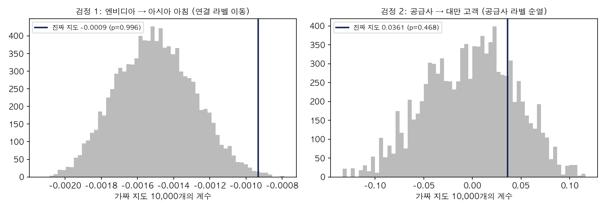
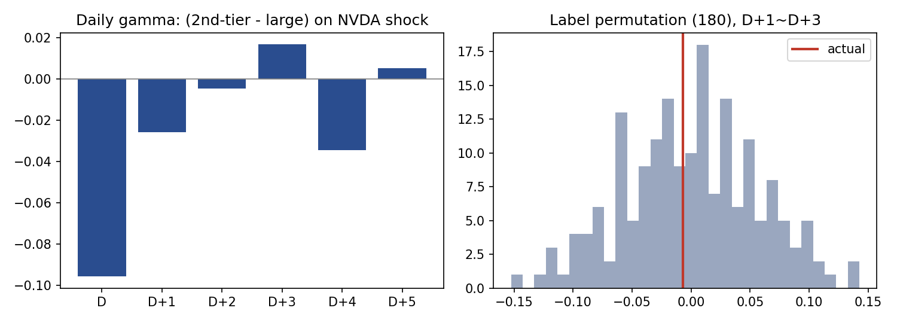
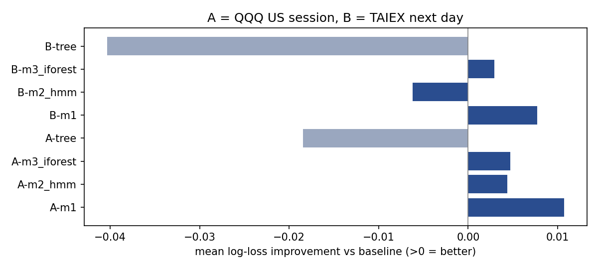

# Week 05. 데이터 기반 전략: 아시아 AI 종목으로 다음 세션을 예측할 수 있는가

## 수행 내용

이번 주에는 아시아 AI·반도체 종목이 다음 시장의 움직임을 미리 보여 주는지 확인했습니다. 가설마다 결과를 보기 전에 판정 기준을 문서로 정해 두었습니다. 여섯 가지 가설을 세웠지만 모두 미리 정한 기준을 넘지 못했고, 사후 매매 필터도 reality check를 통과하지 못했습니다. 수익 신호로 쓸 근거는 없었지만, 마지막 모델로 신호 계산부터 MNQ 주문·청산까지 모의 운영했습니다.

- 연구 데이터: 야후 파이낸스 일봉(5년)·60분봉(약 3년), 한국·일본·대만·홍콩 지수와 AI 관련 종목, 엔비디아, QQQ
- 검증: 사전 고정, 확장형 워크포워드, 블록 부트스트랩, 순열 검정, BH 다중검정 보정, reality check
- 실행 상품: Micro E-mini Nasdaq-100 202612 (`MNQZ26`, `FCME`)
- 실행 환경: NH 모의계좌 주문. 신호 계산은 야후 데이터, 시세·주문 알림은 WebSocket(`FA`, `O1`), 주문·주문내역·잔고·예탁자산 조회는 NH 해외선물 REST API
- 실행일: 2026-11-20 하루 (신호 탐색이 길어져 하루만 실행, [8장](#8-운영-실험))
- 결과: 여섯 가설 모두 사전 기준 미달

## 1. 과제 요약

- 데이터 수집과 가공
  - 야후 일봉·60분봉 수집 (`fetch_yahoo.py`), 분할 오류 수정 (`fix_yahoo.py`)
  - NH 차트 API를 300봉씩 반복 조회해 이어 붙이고 (날짜, 시각)을 키로 중복을 없앤 뒤 상품별 1분봉 길이 점검, 야후 `MNQ=F`와 NH `MNQZ26` 대조 (`early/probe_data.py`, `early/check_mnq_nh.py`)
- 신호 계산과 검증: 가설별 코드와 결과는 [6장](#6-가설별-결과)
- 매매 로직 (`shadow_signal.py`, `live.py`)
  - 아시아 마감 뒤 AI 13종목의 당일 등락 특징 4개(종목 간 표준편차, 상승 종목 비율의 쏠림, 국가 간 평균 차이, 전체 평균 수익률의 크기)로 그날 밤 나스닥이 크게 움직일 확률을 계산
  - 확률 < 0.30이면 23:30 MNQ 1계약 매수, 23:45 청산. 아니면 거래 안 함
- 실행 기록: `results/`에 신호 로그(`signal_log.csv`), 실행 로그(`.log`), 이벤트 기록(`.jsonl`), `screenshots/`에 신호 계산과 주문·체결·최종 잔고 확인 화면

## 2. 실행 방법

```bash
# 저장소 루트에서 실행
python3 -m pip install -r requirements.txt
cp .env.example .env

# 연구 데이터 받기 (원본은 저장소 밖 data/market/week05_yahoo/)
cd week05
python3 fetch_yahoo.py
python3 fix_yahoo.py

# 가설별 검정
python3 network.py          # 가설 3: 공급망 지도
python3 second_tier.py      # 가설 4: 2차 노출 기업 지연
python3 vol_ml.py           # 가설 5: 큰 움직임 예측 (ML)
python3 posthoc_filter.py   # 가설 5 사후 필터 점검
python3 vol_spill.py        # 가설 6: 변동폭 전이

# 운영 실험: 16:10 이후 신호 계산, 23:20쯤 주문 프로그램 실행 (23:30 진입)
python3 shadow_signal.py
cd .. && python3 -m week05.live
```

가설 1·2 코드는 `early/`에 있습니다 (`regress.py`, `regress_mnq.py`, `morning.py`).

### 재현 입력값

| 항목 | 값 | 위치 |
| --- | --- | --- |
| 연구 데이터 | 야후 일봉 `auto_adjust=True` 5년, 60분봉 730일. 11/17~18 수신 | `fetch_yahoo.py` |
| 분석 기간 끝 | 2026-11-11. 11/12 이후(엔비디아 CEO 사임 발표)는 사례로만 | 각 코드 `END` |
| AI 13종목 | 2차 노출 8개(GST, 이수페타시스, 메이코, SWCC, Sunon, Chicony Power, Gold Circuit, ITEQ) + 대형 5개(SK하이닉스, 삼성전자, 도쿄일렉트론, 어드밴테스트, TSMC) | `second_tier.py` `COUNTRY` |
| 워크포워드 | 처음 504일 학습, 21일마다 재학습 | `vol_ml.py` |
| 부트스트랩 | 가설 4~6: 10거래일 원형 블록 1만 회. 가설 2: 10거래일 블록 부호 바꾸기 1,000회. 가설 3은 지도 순열 | `second_tier.py`, `vol_ml.py`, `vol_spill.py`, `early/morning.py`, `network.py` |
| 운영 신호 | 가설 5 방법 1 로지스틱, 11/11까지 994일로 학습해 고정, 문턱 0.30 | `shadow_signal.py` |
| 운영 주문 | 23:30 진입, 23:35 진입 마감, 23:45 청산, 23:52:30 이후 새 주문 중단, 23:53 주문 상태 조회·취소 추적 중단 | `live.py` |

## 3. 전략 선정 배경

아이디어는 [젠슨 황 사임 이후 아시아 증시의 반응을 다룬 기사](https://news.einfomax.co.kr/news/articleView.html?idxno=4444731)에서 얻었습니다.

- 일본·대만: 엔비디아 공급망 종목(어드밴테스트, 도쿄일렉트론, 이비덴)을 중심으로 강세
- 중국·홍콩: AI 모델·하드웨어 종목 중심으로 하락

같은 AI 뉴스인데도 지역별 반응이 달랐다는 점이 눈에 띄었습니다. 여기서 아시아 장의 반응이 뒤이어 열리는 시장을 미리 보여 줄 수 있는지 궁금해졌습니다.

가설은 결과를 보며 이렇게 넓혀 갔습니다.

- 가설 1·2: 기사에서 본 지역 간 차이가 그날 밤 미국장이나 오후 나스닥과 이어지는지
- 가설 3·4: 예측력이 나오지 않아 실제 공급망 관계와 AI 2차 노출 기업으로 범위를 바꿈
- 가설 5·6: 방향 대신 움직임의 크기를 예측

2~4주차에 사용한 이동평균, 개장 범위 돌파, z-score 페어와 겹치지 않도록 이번에는 회귀·네트워크·ML을 사용했습니다. 공지 예시의 변동성 국면은 가설 5의 비교 방법으로만 사용했습니다.

## 4. 데이터 수집과 점검

먼저 NH 모의 서버 1분봉으로 아시아 상품을 점검했습니다 ([데이터 점검](docs/데이터_점검_1117.md)).

- 대만 `FMTWZ26`은 43일 동안 205봉뿐이었고, 엔비디아 개별주식선물 `XNVDAZ26`은 "종목을 찾을 수 없습니다" 오류가 났습니다.
- 만기가 지난 월물은 조회되지 않아, 대만 `TWN`, 홍콩 `HTI`는 근월물 약 20거래일만 쓸 수 있었습니다.

그래서 연구 데이터는 야후 파이낸스에서 받았습니다. 원본 시세는 제3자 제공 금지 원칙에 따라 저장소 밖(`data/market/`)에 두고, 저장소에는 다시 받는 코드와 요약 결과만 올렸습니다.

**대용치 확인**

| 확인 | 결과 |
| --- | --- |
| 야후 `MNQ=F` vs NH `MNQZ26` (38일, 14→16시) | 수익률 상관 0.99 |
| 항셍테크 ETF `3033.HK` vs NH `HTIX26` | 장중 수익률 상관 0.955 |
| 60분봉 첫 봉 시가 vs 일봉 시가 | 상관 0.9997 이상 |

**야후 분할 오류**

가설 4 사후 분석에서 일본 대형주 신호의 하루 표준편차가 14.7%로 나와 원본을 확인했습니다.

- TOPIX ETF `1306.T`: 2026-03-30 1:10 분할이 일봉 이틀에만 이중 반영됐고, 60분봉은 분할 전 가격이 수정되지 않았습니다. 분할은 운용사 공지로 확인했습니다.
- GST `083450.KQ`: 2024-06-17에 전날 대비 약 1/2로 끊겨 있었습니다. 공식 자료는 확인하지 못해, 가격 연속성만 보고 고쳤습니다.

`fix_yahoo.py`로 고친 뒤 가설 3·4·5를 모두 다시 돌렸습니다. 가설 3 검정 1의 순열 p가 0.90에서 0.996으로 바뀌었고, 결론은 같았습니다.

## 5. 검증 방법

- **사전 고정**: 가설마다 결과를 보기 전에 질문, 데이터, 정의, 판정 기준을 `docs/`에 적었습니다. 결과를 본 뒤 바꾼 것은 "사후" 또는 "탐색적"으로 따로 표시했습니다.
- **미래 정보 차단**: 표준화·β·임계값은 그 시점 이전 자료로만 계산했습니다. ML은 확장형 워크포워드로 표본 밖 예측만 평가했습니다.
- **추론**: 일별 수익률은 서로 독립이 아니라서, Newey-West 표준오차와 날짜 블록 부트스트랩을 함께 썼습니다. 회사 라벨이나 연결선을 섞는 순열 검정으로 "진짜 관계가 가짜 관계보다 나은가"를 봤습니다.
- **다중검정**: 한 가설 안의 여러 검정에는 BH 보정을 적용했습니다.
- **reality check**: 결과를 보고 고른 규칙은 신호를 날짜로 밀어 만든 가짜 표본에서도 같은 선택 과정을 반복해, 그중 최고 성과와 비교했습니다.

## 6. 가설별 결과

| # | 질문 | 사전·사후 | 판정 기준 | 결과 | 다음 결정 |
| --- | --- | --- | --- | --- | --- |
| 1 | 아시아 지역 지수가 서로 갈린 정도로 그날 밤 엔비디아·나스닥을 예측할 수 있는가 | 사전 | HAC BH 유의 + 워크포워드 개선 | 12개 검정 모두 미달, 표본 외 R² 음수 | 시간 단위를 줄여 가설 2로 |
| 2 | 아시아 오전장 갈림으로 같은 날 오후 MNQ를 예측할 수 있는가 | 사전 (탐색적) | 부트스트랩 p < 0.10 + 워크포워드 개선 | 4개 모두 미달 (p 0.19~0.61) | 지역 대신 공급망으로 |
| 3 | 공개된 AI 공급망 관계를 따라 가격이 1시간 안에 퍼지는가 | 사전 | 순열 p < 0.10, 계수 양수, 두 검정 BH q < 0.10 | 검정 1 p 0.996, 검정 2 p 0.25 | AI 2차 노출 기업·며칠 단위로 |
| 4 | 엔비디아 충격 뒤 AI 2차 노출 중소형주가 대형 반도체보다 며칠 늦게 따라가는가 | 사전 | 블록 부트스트랩 단측 p < 0.05, γ > 0 | γ −0.007, p 0.54 | 방향 대신 크기 예측으로 |
| 5 | 아시아 AI 13종목 정보로 다음 세션의 큰 움직임을 맞힐 수 있는가 (ML) | 사전 (4 결과 뒤 추가) | log-loss 개선, BH q < 0.10 | 6개 모두 미달 (최소 p 0.079, q 0.28) | 기존 연구의 효과로 마지막 확인 |
| 6 | 아시아 AI 종목 변동폭이 그날 밤 미국장 변동폭을 더 잘 맞히게 하는가 | 사전 (5 결과 뒤 추가) | 제곱오차 개선, p < 0.05 | R² +0.4%, p 0.30 | 탐색 중단 |

가설 번호와 `docs/` 문서 번호는 다릅니다. 가설 1은 `3단계`, 가설 2는 `4단계`, 가설 3~6은 `5단계`~`8단계` 문서입니다.

### 6-1. 가설 1·2: 아시아 지역 갈림

상관과 군집을 계산해 보니 대만·닛케이와 홍콩·중국이 서로 다른 묶음으로 나뉘었습니다([상관·군집](docs/2단계_상관_군집_1117.md)). 두 지역의 차이가 그날 밤 미국장과 이어지는지 확인했습니다.

- 가설 1 ([결과](docs/3단계_회귀결과_1117.md)): 수익률은 HAC·순열 모두 유의하지 않았고, 갈림 점수를 넣으면 표본 외 R²가 오히려 낮아졌습니다(엔비디아 −1.86%, QQQ −1.33%). 변동성은 순열 p만 작고 HAC와 워크포워드는 받쳐 주지 않았습니다.
- 가설 2 ([결과](docs/4단계_오전장_결과_1117.md)): 466일, 4개 검정 모두 부트스트랩 p 0.19 이상이었습니다.

### 6-2. 가설 3: AI 공급망 지도

엔비디아와 공급·협력 관계가 있는 회사(TSMC, SK하이닉스, 서버 ODM 등)와, 한국·일본 장비·소재사가 대만 고객사에 납품하는 관계를 공개 자료로 지도에 담았습니다(`map/`). 연결은 처음 공개된 다음 거래일부터 켰습니다 ([결과](docs/5단계_공급망지도_결과_1118.md)).



- 검정 1: 엔비디아 밤 움직임에 연결된 회사가 아침 1시간에 더 따라가지 않았습니다(순열 p 0.996).
- 검정 2: 가능한 가짜 지도가 4개뿐이라 p의 최솟값이 0.25입니다. 이 설계로는 10% 기준을 넘을 수 없다는 점을 결과를 본 뒤 알았고, 한계로 적었습니다.

### 6-3. 가설 4: AI 2차 노출 기업

대형주는 정보가 빨리 반영되니, 냉각·전원·PCB 같은 AI 2차 노출 기업은 늦게 따라갈 수 있다고 봤습니다 ([결과](docs/6단계_2차수혜_결과_1118.md)).



- 엔비디아 충격 당일(D)에는 대형주가 더 크게 움직이는 방향의 계수가 나왔지만(γ_D −0.096), 그 뒤 며칠 동안 2차 노출 기업이 따라잡지 않았습니다.
- 신호를 아시아 대형 AI주로 바꾼 사후 분석도 p 0.34였습니다.

### 6-4. 가설 5: 큰 움직임 예측 (ML)

방향 예측에서 신호가 나오지 않아, 이번에는 다음 시장이 평소보다 크게 움직일지를 예측했습니다. 대상의 과거 변동성만 쓴 기본 모델에 세 가지 방법을 하나씩 추가하고 표본 밖 log-loss를 비교했습니다 ([결과](docs/7단계_변동성ML_결과_1119.md)).



| 대상 | 등락 특징 | HMM 국면 | Isolation Forest |
| --- | ---: | ---: | ---: |
| QQQ 미국 정규장 (MNQ 대용) | p 0.079 | p 0.19 | p 0.17 |
| 대만 다음 날 (TWN 대용) | p 0.14 | p 0.92 | p 0.29 |

- HMM은 그날까지 자료만 쓰는 필터링 확률만 특징으로 썼습니다.
- 기본 모델이 고정 30% 예측보다도 못했습니다. 라벨 자체가 최근 60일 변동성을 기준으로 정해져 있어, 기본 모델에 넣은 과거 변동성 정보가 별 도움이 되지 않았을 수 있습니다. 결과를 본 뒤 라벨은 바꾸지 않았습니다.

### 6-5. 가설 6: 변동폭 전이

한 시장의 변동성이 다음에 열리는 시장으로 넘어간다는 기존 연구(Engle, Ito & Lin 1990)를 아시아 AI 종목에 적용했습니다 ([결과](docs/8단계_변동성전이_결과_1119.md)).

- 미국장 자기 과거 변동폭(HAR) 대비 개선은 R² +0.4%, p 0.30이었습니다. 지수 변동폭으로 바꿔도 +1.7%, p 0.21이었습니다.

## 7. 사후 필터와 reality check

가설 5의 등락 특징 모델 확률이 0.30 미만인 날만 QQQ 정규장을 보유하는 규칙을 결과를 본 뒤 만들어 봤습니다.

| | 매일 보유 | 필터 (확률 < 0.30) |
| --- | ---: | ---: |
| 샤프 | 0.01 | 1.02 |
| 최대 낙폭 | −20% | −6% |
| 고정 규칙 기준 p (무작위 날짜 / 원형 이동) | | 0.022 / 0.037 |

겉보기에는 좋았지만, 추가 점검(`posthoc_filter.py`)에서 우연과 구분되지 않았습니다.

| 점검 | 결과 |
| --- | --- |
| reality check (아시아 특징을 200번 밀어 모델 4개 × 문턱 4개 중 최고 샤프) | 가짜 중앙값 0.98, 95% 1.52, **p 0.46** |
| 보유일 vs 회피일 변동성 | 19.1% vs 17.1%. 조용한 날을 고르지 못함 |
| 하락일·상승일 회피율 | 54% vs 52%. 차이가 작음 |
| 문턱 0.25 / 0.30 / 0.35 / 0.40 샤프 | −0.07 / 1.02 / 0.47 / 0.36. 0.30에서만 튐 |

그래서 이 규칙은 수익 전략으로 채택하지 않았습니다.

## 8. 운영 실험

운영 실험에서는 수익보다 데이터 수신, 확률 계산, 주문과 청산이 실제로 이어지는지를 확인했습니다. 규칙은 11/19에 동결했습니다. 가설 5·6까지 분석하느라 운영은 11/20(금) 하루만 진행했습니다.

### 8-1. 규칙

| 단계 | 내용 |
| --- | --- |
| 신호 계산 (16:10 이후) | 야후에서 AI 13종목 당일 종가를 받아 등락 특징 4개와 QQQ 과거 변동성 2개로 확률 계산. 모델은 11/11까지 자료로 학습한 그대로 사용 |
| 거래 여부 | 확률 < 0.30이면 매수, 아니면 거래 안 함. 10종목 미만이거나 세 나라 중 휴장이 있으면 거래 안 함 |
| 진입 | 23:30 MNQ 1계약 시장가 매수. 23:35가 지나면 진입 안 함. 최근 10초 안의 체결 시세가 없으면 진입 안 함 |
| 청산 | 23:45 시장가 매도 |

연구에서는 미국 정규장 시가부터 종가까지 보유했지만, 해외 모의 서버가 24:00에 닫혀 23:45에 청산합니다. 그래서 이 실험의 손익은 연구 신호의 성과로 보지 않습니다.

### 8-2. 주문 안전 장치

- 주문번호를 받은 주문은 체결·거부·취소가 확정될 때까지 추적합니다(WebSocket 10초, REST 5회, 취소 요청 뒤 다시 확인). 23:53이 되면 확정 전이라도 추적을 멈춥니다.
- 미체결 주문이 남아 있으면 다음 주문을 내지 않고, 청산은 실제 잔고의 반대 방향으로만 냅니다. 청산 주문이 늦게 체결돼 숏으로 뒤집히는 경우를 막기 위해서입니다.
- 23:52:30 이후에는 새 주문을 내지 않습니다.
- 시작할 때 포지션이나 미체결이 있으면 실행하지 않고, 끝날 때 잔고를 다시 확인합니다.
- 가짜 브로커로 즉시 체결, 확인 지연, 미체결 후 취소, 취소 실패 후 늦은 체결, 컷오프 이후 상황을 시험했습니다.

### 8-3. 실행 결과

(11/20 실행 후 작성)

| 날짜 | 확률 | 결정 | 진입 | 청산 | 손익 |
| --- | ---: | --- | ---: | ---: | ---: |
| 11/20 | | | | | |

## 9. 해석과 한계

- 여섯 가설 가운데 다음 세션까지 이어지는 추가 예측력을 보인 것은 없었습니다.
- 종목 선택 편향: AI 관련 종목은 2026년 시점에 골랐습니다. 가설 4는 반응 기울기를, 가설 5·6은 등락 특징·변동폭을 썼지만, 종목 선택 편향이 얼마나 줄었는지는 확인하지 못했습니다.
- 다중 탐색: 가설 5·6은 앞선 결과를 본 뒤 추가했습니다. 가설마다 기준을 미리 정했지만, 연구 전체로 보면 여러 번 시도한 셈이라 개별 p값을 그대로 믿기 어렵습니다.
- 데이터: 야후 데이터는 공식 체결 자료가 아니고, 분할 오류처럼 직접 점검해야 하는 부분이 있었습니다. 60분봉 마지막 봉 종가는 일봉 종가와 다른 날이 있었습니다. 11/20에 13종목 최근 40일을 비교했을 때 차이 중앙값은 0.15~0.52%, 최대 7.1%(GST)였습니다(`check_close_60m.py`, `results/check_close_60m.csv`). 마감 동시호가가 60분봉에 빠진 것으로 추정해, 운영 신호에는 일봉 종가만 썼습니다.
- 신호 탐색에 시간을 더 쓰느라 운영 실험은 하루뿐입니다. 결과는 파이프라인이 작동하는지에 대한 확인일 뿐, 통계적 증거가 아닙니다. 다시 한다면 탐색 기한부터 정하고 운영 실험을 먼저 시작할 생각입니다.

## 10. 오류 제보 후보

| 현상 | 내용 |
| --- | --- |
| 개별주식선물 조회 불가 | 종목 마스터(`cme_fut.mst`)에 있는 `XNVDAZ26`, `SNVDAZ26`, `XTSLAZ26` 등이 모의 서버 차트 API에서 "종목을 찾을 수 없습니다"로 조회되지 않음 |

## 11. 폴더 구성

| 경로 | 내용 |
| --- | --- |
| `fetch_yahoo.py`, `fix_yahoo.py` | 야후 데이터 수집, 분할 오류 수정 |
| `early/` | 가설 1·2 코드(`regress.py`, `regress_mnq.py`, `morning.py`)와 데이터 점검, 결과 |
| `map/` | AI 공급망 지도 (회사, 연결, 근거 링크, 공개일) |
| `network.py` | 가설 3 |
| `second_tier.py`, `second_tier_posthoc.py` | 가설 4와 사후 분석 |
| `vol_ml.py`, `posthoc_filter.py` | 가설 5와 사후 필터 점검 |
| `vol_spill.py` | 가설 6 |
| `shadow_signal.py`, `live.py` | 운영 실험 신호 계산, 모의 주문 |
| `check_close_60m.py` | 60분봉 마지막 종가와 일봉 종가 비교 |
| `docs/` | 가설별 사전 고정과 결과 문서 |
| `results/`, `figs/` | 검정 결과 요약 CSV, 그림, 운영 로그 |
| `screenshots/` | 운영 실험 실행 화면 |
