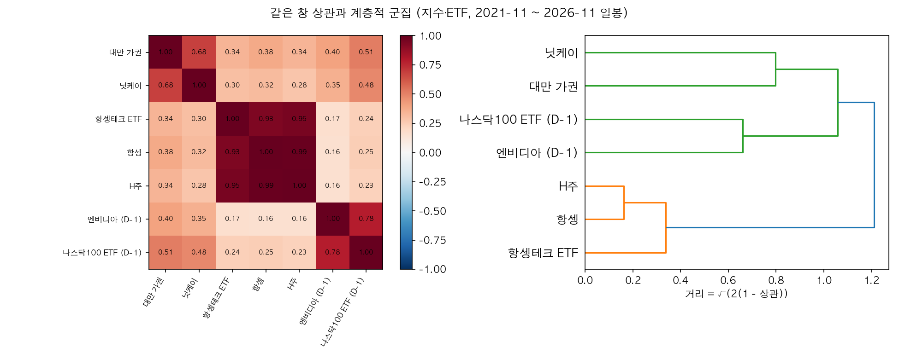
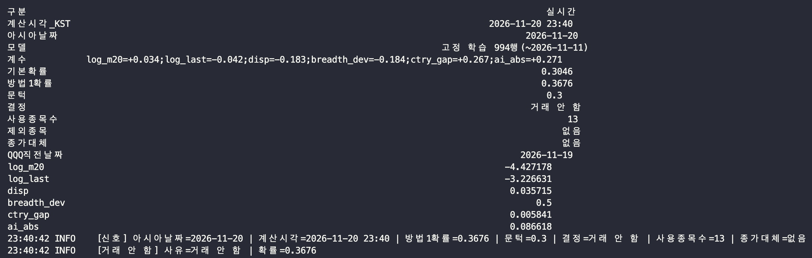

# Week 05. 데이터 기반 전략: 아시아 AI 종목으로 다음 세션을 예측할 수 있는가

## 수행 내용

아시아 AI, 반도체 종목이 다음에 열리는 시장의 움직임을 미리 보여 주는지 확인했습니다. 가설 여섯 개를 세우고 각각 결과를 보기 전에 판정 기준을 정해 검증했지만, 모두 기준을 넘지 못했습니다. 결과를 본 뒤 만든 매매 규칙도 reality check를 통과하지 못해, 수익 전략이 아니라 주문 과정을 확인하는 용도로만 모의 운영했습니다.

- 상품: Micro E-mini Nasdaq-100 202612 (`MNQZ26`), CME
- 전략: 아시아 AI 13종목의 당일 등락으로 그날 밤 나스닥이 크게 움직일 확률을 계산, 확률이 낮은 날만 미국장 개장 직후 매수
- 실행 환경: 모의계좌 주문
- 실행일: 2026-11-20
- 실행 결과: 확률 0.368로 거래 안 함

## 1. 과제 요약

- 데이터 수집
  - 야후 파이낸스 일봉 5년, 60분봉 약 3년 (`yahoo/`)
  - NH 차트 API로 아시아 선물 데이터 점검 (`research/initial/probe_data.py`)
- 가설 검증: 6개, [6절](#6-가설-검증)
- 진입, 청산: 아시아장 마감 뒤 확률 계산, 0.30 미만이면 23:30 매수, 23:45 청산 (`daily_signal.py`, `live.py`)
- 실행 기록: `results/`에 신호 기록(`signal_log.csv`), 실행 로그(`.log`), 이벤트 기록(`.jsonl`) 저장

## 2. 실행 방법

```bash
# 저장소 루트에서 실행
# 패키지 설치 후 .env에 API 키 입력
python3 -m pip install -r requirements.txt
cp .env.example .env

# 연구 데이터 받기
cd week05
python3 yahoo/fetch_yahoo.py
python3 yahoo/fix_yahoo.py

# 가설 검증
python3 research/network.py                # 가설 3
python3 research/second_tier_delay.py      # 가설 4
python3 research/vol_ml.py                 # 가설 5
python3 research/vol_ml_posthoc.py         # 가설 5 결과를 본 뒤 만든 규칙 점검
python3 research/volatility_spillover.py   # 가설 6

# 신호 계산: 아시아장 종가가 들어온 뒤(16:10 이후) 실행
python3 daily_signal.py

# 모의계좌 주문: 23:30에 진입하므로 그 전에 실행
cd .. && python3 -m week05.live
```

## 3. 전략과 매매 계획

### 3-1. 대상 상품

NH 모의 API에는 대만 선물 과거 데이터가 부족하고 아시아 개별 종목 선물도 없어, 나스닥 마이크로 선물로 실행했습니다.

- 호가단위(1틱): 0.25, 1계약 기준 $0.5
- 최종거래일: 2026-12-18

### 3-2. 전략 근거

[젠슨 황 사임 이후 아시아 증시의 반응을 다룬 기사](https://news.einfomax.co.kr/news/articleView.html?idxno=4444731)에서 출발했습니다.

- 일본, 대만: 엔비디아 공급망 종목(어드밴테스트, 도쿄일렉트론, 이비덴)을 중심으로 강세
- 중국, 홍콩: AI 모델과 하드웨어 종목 중심으로 하락

같은 AI 뉴스인데도 지역별 반응이 달랐다는 점이 눈에 띄었습니다. 여기서 아시아장의 반응이 뒤이어 열리는 시장을 미리 보여 줄 수 있는지 궁금해졌습니다.

- 가설 1, 2: 기사에서 본 지역 간 차이가 그날 밤 미국장이나 오후 나스닥과 이어지는지
- 가설 3, 4: 예측력이 나오지 않아 실제 공급망 관계와 AI 2차 수혜 기업으로 범위를 바꿈
- 가설 5, 6: 방향 대신 움직임의 크기를 예측

2~4주차의 이동평균, 개장 범위 돌파, z-score 페어와 겹치지 않도록 회귀, 네트워크, ML을 사용했습니다. 공지 예시의 변동성 국면은 가설 5의 비교 방법으로만 썼습니다.

### 3-3. 매매 규칙

확률 형태의 신호와 매매 규칙을 구현한 가설 5의 모델을 11/19에 고정해 사용했습니다.

- 신호 (16:10 이후)
  - 아시아 AI 13종목 당일 수익률로 등락 특징 4개 계산: 종목 간 표준편차, 상승 종목 비율의 쏠림, 국가 간 평균 차이, 전체 평균 수익률의 크기
  - QQQ 과거 변동성 2개와 함께 로지스틱 회귀로 그날 밤 미국장이 크게 움직일 확률 계산
  - 모델은 11/11까지 994일 자료로 학습한 그대로 사용
- 진입
  - 확률 0.30 미만이면 23:30 MNQ 1계약 시장가 매수
  - 확률 0.30 이상이거나, 13종목 중 10종목 미만이거나, 세 나라 중 휴장이 있으면 거래 안 함
- 청산: 23:45 시장가 매도

연구에서는 미국 정규장 시가부터 종가까지 보유했지만, 해외 모의 서버가 24:00에 닫혀 23:45에 청산합니다. 그래서 이 실행의 손익은 연구 신호의 성과로 보지 않습니다.

### 3-4. 주문 처리

- 시작 시 포지션이나 미체결 주문이 있음: 실행 안 함
- 23:35 이후 실행 또는 최근 10초 안의 체결 시세 없음: 진입 안 함
- 주문 확정 확인: WebSocket 10초, REST 5회. 그래도 미확정이면 취소 요청 후 재확인하고, 미체결이 남아 있으면 다음 주문을 내지 않음
- 청산: 실제 잔고의 반대 방향으로만 주문. 늦은 체결로 매도 포지션으로 뒤집히는 경우 방지
- 마감: 23:52:30 이후 새 주문 금지, 23:53에 개별 주문 추적을 멈추고 전체 포지션과 미체결 재확인
- 사전 시험: 가짜 브로커로 즉시 체결, 체결 확인 지연, 미체결 후 취소, 취소 실패 후 늦은 체결, 마감 시각 이후 상황 확인

## 4. 사용 API와 구조

### 4-1. 사용 API

| 구분 | API | 사용 방식 |
| --- | --- | --- |
| 인증 | `auth-service/v1/token` | 토큰 만료 5분 전 재발급 |
| 시세 | `overseas/chart-minute` | 아시아 선물 데이터 점검 (300개씩 `nxt_key`로 이어서 조회, (날짜, 시각) 기준 중복 제거) |
| | WebSocket `FA` | 진입 직전 MNQ 체결 시세 수신 |
| 주문 | `overseas/order` | 시장가 매수, 매도, 확정되지 않은 주문 취소 |
| | WebSocket `O1`, `overseas/order-history` | 체결 확인, 미체결 확인 |
| 계좌 | `overseas/deposit` | 시작과 종료 시 예탁자산 확인 |
| | `overseas/open-interest` | 시작과 종료 시 포지션 확인 |

11/20 실행에서는 신호가 거래 안 함이라 주문, 계좌 API는 호출되지 않았습니다.

### 4-2. 구조

```text
week05/
  daily_signal.py            신호 계산
  live.py                    모의계좌 주문 (week03의 broker.py, stream.py 재사용)
  yahoo/
    fetch_yahoo.py           야후 데이터 수집
    fix_yahoo.py             야후 분할, 가격 불연속 보정
    check_close_60m.py       60분봉 마지막 종가와 일봉 종가 비교
  research/
    second_tier_delay.py     가설 4, 데이터 읽기 등 공통 함수
    second_tier_posthoc.py   가설 4 결과를 본 뒤 추가 분석
    network.py               가설 3
    vol_ml.py                가설 5
    vol_ml_posthoc.py        가설 5 결과를 본 뒤 만든 규칙 점검
    volatility_spillover.py  가설 6
    map/                     AI 공급망 지도 (회사, 연결, 근거 링크, 공개일)
    initial/                 가설 1, 2 코드, NH 데이터 점검, 결과
  docs/                      가설별 사전 고정, 결과 문서
  results/                   결과 CSV, 실행 로그
  figs/                      그림
  screenshots/               실행 화면
```

## 5. 실행 환경

- 실행 방식: 모의계좌 주문
- 신호 데이터: 야후 파이낸스 일봉 (아시아장 마감 뒤)
- 시세: 주문 조건을 충족하면 WebSocket 실시간 수신 (진입 2분 전 접속)
- 실행 시간: 2026-11-20 23:40
- 실행 기록: `results/signal_log.csv`, `results/live_20261120_234042.log`, `results/events_20261120_234042.jsonl`

## 6. 가설 검증

### 6-1. 데이터 수집과 점검

- NH 모의 서버는 아시아 선물 기간이 짧아 연구 데이터는 야후 파이낸스에서 받았습니다([데이터 점검](docs/0_데이터점검.md)).
  - 대만 `FMTWZ26` 43일 205봉, 만기 지난 월물 조회 불가, 엔비디아 선물 조회 오류
- 원본 시세는 저장소 밖에 두고, 저장소에는 다시 받는 코드와 요약 결과만 올렸습니다.
- 야후 분할 오류 2건(TOPIX ETF `1306.T`, GST `083450.KQ`)을 `yahoo/fix_yahoo.py`로 고친 뒤 가설 3, 4, 5를 다시 돌렸고, 결론은 같았습니다([가설 4 결과](docs/가설4_2차수혜_지연반응_결과.md#고친-점)).

| 대용 데이터 확인 | 결과 |
| --- | --- |
| 야후 `MNQ=F` vs NH `MNQZ26` (38일, 14→16시) | 수익률 상관 **0.99** |
| 항셍테크 ETF `3033.HK` vs NH `HTIX26` | 장중 수익률 상관 **0.955** |
| 60분봉 첫 봉 시가 vs 일봉 시가 | 상관 **0.9997** 이상 |

### 6-2. 검증 방법

- 사전 고정: 가설마다 결과를 보기 전에 질문, 데이터, 정의, 판정 기준을 `docs/`에 적음. 결과를 본 뒤 추가한 분석은 따로 표시
- 시점 분리: 표준화, 베타, 기준값은 그 시점 이전 자료로만 계산
- 워크포워드: ML은 처음 504일로 학습하고 21일마다 다시 학습하며, 학습에 쓰지 않은 날만 평가
- 자기상관: Newey-West 표준오차와 10거래일 블록 부트스트랩을 함께 사용
- 순열 검정: 회사 라벨과 공급망 연결선을 무작위로 재배치
- 다중검정: 한 가설 안의 여러 검정에 BH 보정

### 6-3. 가설별 결과

| # | 질문 | 기준 설정 | 판정 기준 | 결과 | 다음 결정 |
| --- | --- | --- | --- | --- | --- |
| 1 | 일본, 대만과 홍콩, 중국의 차이 → 그날 밤 엔비디아, 나스닥 | 사전 | HAC BH 유의 + 워크포워드 개선 | **미달** (12개 모두, 표본 외 R² 음수) | 시간 단위를 줄여 가설 2로 |
| 2 | 같은 차이를 오전장으로 → 같은 날 오후 MNQ | 사전 (탐색적) | 부트스트랩 p < 0.10 + 워크포워드 개선 | **미달** (4개 모두, p 0.19~0.61) | 지역 대신 공급망으로 |
| 3 | 공개 AI 공급망 관계를 따라 1시간 안에 전파 | 사전 | 순열 p < 0.10, 계수 양수, BH q < 0.10 | **미달** (p 0.996, 0.25) | 2차 수혜 기업, 며칠 단위로 |
| 4 | 엔비디아 충격 뒤 2차 수혜 중소형주가 대형주보다 며칠 늦게 반응 | 사전 | 부트스트랩 단측 p < 0.05, γ > 0 | **미달** (γ −0.007, p 0.54) | 방향 대신 크기 예측으로 |
| 5 | 아시아 AI 13종목 → 다음 세션의 큰 움직임 (ML) | 사전 (4 결과 뒤 추가) | log-loss 개선, BH q < 0.10 | **미달** (6개 모두, 최소 p 0.079, q 0.28) | 변동폭 전이 가설로 |
| 6 | 아시아 AI 종목 변동폭 → 그날 밤 미국장 변동폭 | 사전 (5 결과 뒤 추가) | 제곱오차 개선, p < 0.05 | **미달** (R² +0.4%, p 0.30) | 탐색 중단 |

#### 가설 1, 2. 아시아 지역 간 반응 차이

- 방법: 상관과 군집에서 대만, 닛케이와 홍콩, 중국이 서로 다른 묶음으로 나뉘어, 두 지역의 차이를 신호로 사용
- 결과
  - 수익률: 지역 차이를 넣으면 표본 외 R²가 오히려 낮아짐(엔비디아 −1.86%, QQQ −1.33%)
  - 변동성: 순열 p만 작고 HAC와 워크포워드는 받쳐 주지 않음
- 문서: [상관과 군집](docs/0_상관군집.md), [가설 1 결과](docs/가설1_아시아지역차이_미국장_결과.md), [가설 2 결과](docs/가설2_오전장지역차이_오후MNQ_결과.md)



#### 가설 3. AI 공급망 지도

- 방법: 엔비디아와 아시아 공급사, 한국, 일본 장비 소재 회사와 대만 고객사의 관계를 공개 자료로 지도에 담고(`research/map/`), 연결은 처음 공개된 다음 거래일부터 반영
- 한계: 검정 2는 만들 수 있는 가짜 지도가 4개뿐이라 p의 최솟값이 0.25. 이 설계로는 10% 기준을 넘을 수 없다는 점을 결과를 본 뒤 알게 됨
- 문서: [가설 3 결과](docs/가설3_공급망지도_가격전파_결과.md)


#### 가설 4. AI 2차 수혜 기업

- 방법: 대형 반도체주보다 냉각, 전원, PCB 등 2차 수혜 기업의 반응이 늦게 나타나는지 확인
- 결과
  - 충격 당일(D)에는 대형주가 더 크게 움직이는 방향이었지만(γ_D −0.096), 그 뒤 2차 수혜 기업이 따라잡지 않음
  - 신호를 아시아 대형 AI주로 바꾼 사후 분석도 p 0.34
- 문서: [가설 4 결과](docs/가설4_2차수혜_지연반응_결과.md)


#### 가설 5. 큰 움직임 예측 (ML)

- 방법: 과거 변동성만 쓴 기본 모델에 세 방법(등락 특징, HMM 국면, 이상치 점수)을 하나씩 더해 학습에 쓰지 않은 날의 log-loss 비교
  - HMM은 그날까지의 자료만으로 계산한 국면 확률 사용
- 참고: 기본 모델이 고정 30% 예측보다도 못함
  - 라벨이 최근 60일 변동성 기준이라 과거 변동성 정보가 별 도움이 되지 않았을 수 있음. 결과를 본 뒤 라벨은 바꾸지 않음
- 문서: [가설 5 결과](docs/가설5_큰움직임예측ML_결과.md)

| 대상 | 등락 특징 | HMM 국면 | 이상치 점수 |
| --- | ---: | ---: | ---: |
| QQQ 미국 정규장 (MNQ 대용) | **p 0.079** | p 0.19 | p 0.17 |
| 대만 다음 날 (TWN 대용) | p 0.14 | p 0.92 | p 0.29 |


#### 가설 6. 변동폭 전이

- 방법: 한 시장의 변동성이 다음에 열리는 시장으로 넘어간다는 기존 연구(Engle, Ito & Lin 1990)를 아시아 AI 종목에 적용
- 보조: 아시아 종목 대신 지수 변동폭을 써도 R² +1.7%, p 0.21
- 문서: [가설 6 결과](docs/가설6_변동폭전이_결과.md)

### 6-4. 결과를 본 뒤 만든 매매 규칙

가설 5 결과를 확인한 뒤, 모델 확률이 0.30 미만인 날만 QQQ 정규장을 보유하는 규칙을 만들었습니다.

| | 매일 보유 | 확률 0.30 미만인 날만 보유 |
| --- | ---: | ---: |
| 샤프 | 0.01 | **1.02** |
| 최대 낙폭 | −20% | **−6%** |
| 규칙을 고정했을 때 p (무작위 날짜 / 원형 이동) | | 0.022 / 0.037 |

겉보기에는 좋았지만, 추가 점검(`research/vol_ml_posthoc.py`)에서 우연과 구분되지 않아 수익 전략으로 채택하지 않았습니다.

| 점검 | 결과 |
| --- | --- |
| reality check: 아시아 데이터의 날짜를 200번 원형 이동하고, 모델 4개 × 임계값 4개 중 최고 샤프 비교 | 재배열 표본 중앙값 0.98, 상위 5% 1.52, **p 0.46** |
| 보유한 날 vs 쉰 날 변동성 | 19.1% vs 17.1%. **조용한 날을 고르지 못함** |
| 하락일과 상승일을 쉰 비율 | 54% vs 52%. **차이가 작음** |
| 임계값 0.25 / 0.30 / 0.35 / 0.40일 때 샤프 | −0.07 / 1.02 / 0.47 / 0.36. **0.30에서만 좋음** |

## 7. 실행 결과

### 7-1. 모의계좌 실행

| 날짜 | 계산 시각 | 확률 | 결정 | 사용 종목 | 주문 |
| --- | --- | ---: | --- | ---: | --- |
| 11/20 | 23:40 | **0.368** | **거래 안 함** (0.30 이상) | 13 | 없음 |

- 이날 아시아 AI 13종목은 모두 같은 방향으로 움직였고, 평균 수익률의 절댓값은 8.7%였습니다.
- 신호 계산, 로그 기록, 거래 안 함 처리는 확인했지만 주문, 체결, 청산은 실제로 확인하지 못했습니다.

### 7-2. 화면 캡처



## 8. 결과 해석과 한계

- 여섯 가설 가운데 다음 세션까지 이어지는 추가 예측력을 보인 것은 없었습니다.
- AI 관련 종목은 2026년 시점에 골랐습니다. 종목 선택 편향이 결과에 얼마나 영향을 줬는지는 확인하지 못했습니다.
- 가설 5, 6은 앞선 결과를 본 뒤 추가했습니다. 가설마다 기준을 미리 정했지만, 연구 전체로 보면 여러 번 시도한 셈이라 개별 p값을 그대로 믿기 어렵습니다.
- 야후 60분봉 마지막 봉 종가는 일봉 종가와 다른 날이 있어 신호에는 일봉 종가만 썼습니다.
  - 13종목 최근 40일 차이 중앙값 0.15~0.52% (`results/check_close_60m.csv`)
- 가설 5, 6까지 분석하느라 모의계좌 실행은 하루뿐입니다. 이 실행은 주문 과정 확인일 뿐, 통계적 증거가 아닙니다.

## 9. 향후 계획

- 탐색 기한을 미리 정하고, 모의계좌 실행을 먼저 시작해 두기
- 같은 규칙으로 며칠 더 실행해 실제 주문, 체결, 청산까지 확인하기
- 가설 5의 라벨을 최근 변동성과 상관없는 기준(예: 절댓값 기준)으로 바꿔 새로 사전 고정하고 다시 검증하기
- NH API에서 받을 수 있는 아시아 선물 데이터가 쌓이면 야후 대신 같은 질문을 다시 확인하기
