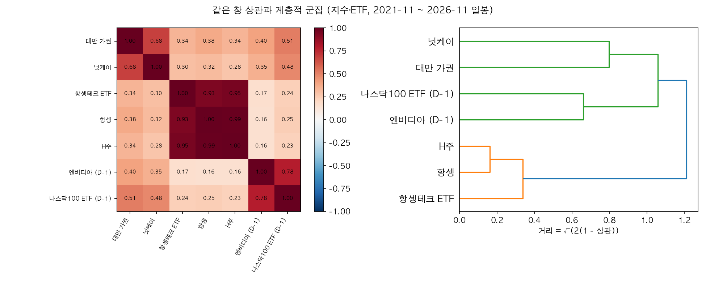
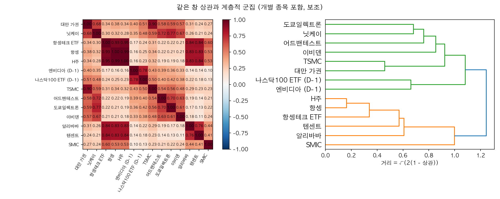

# 초기 탐색: 시장 간 상관과 군집 (11/17)

## 관련 파일

- 코드: `research/initial/explore_daily.py`, `research/initial/explore_daily2.py`
- 그림: `research/initial/figs/cluster_main.png`, `research/initial/figs/cluster_aux.png`

## 목적

기사에서 본 "일본, 대만과 홍콩, 중국의 반응 차이"가 데이터에서도 보이는지, 아시아 시장이 실제로 어떤 묶음으로 움직이는지 확인했습니다.

## 데이터와 날짜 맞추기

- 야후 일봉(`auto_adjust=True`), 시장마다 현지 통화 로그수익률
- 기간
  - 아시아 거래일 합집합: 1,298일(2021-11-18 ~ 2026-11-16)
  - 다섯 지수가 모두 있는 날: 1,093일
- 한국 시간 기준 순서: 미국 D-1 정규장 → 아시아 D → 미국 D 정규장
  - 군집: 아시아 D 종가→종가와 미국 D-1 종가→종가를 같은 날로 묶음. 아시아 D-1 종가와 D 종가 사이에 미국 D-1 장이 들어가기 때문
  - 선행 관계: 아시아 D 종가→종가와 미국 D 시가→종가. 미국 D가 휴장이면 제외

## 결과

### 같은 창 상관

| | 대만 | 닛케이 | 항셍테크 ETF | 항셍 | H주 | 엔비디아 D-1 | QQQ D-1 |
| --- | ---: | ---: | ---: | ---: | ---: | ---: | ---: |
| 대만 가권 | 1 | 0.68 | 0.34 | 0.38 | 0.34 | 0.40 | 0.51 |
| 닛케이 | | 1 | 0.30 | 0.32 | 0.28 | 0.35 | 0.48 |
| 항셍테크 ETF | | | 1 | 0.93 | 0.95 | 0.17 | 0.24 |
| 엔비디아 D-1 | | | | | | 1 | 0.78 |

### 계층적 군집

- 방법: 거리 √(2(1 − 상관)), 평균 연결로 두 묶음
- 묶음 1: 항셍테크 ETF, 항셍, H주, 알리바바, 텐센트, SMIC
- 묶음 2: 대만 가권, 닛케이, 엔비디아, QQQ, TSMC, 어드밴테스트, 도쿄일렉트론, 이비덴
- 개별 종목 상관
  - 공급망 종목: 엔비디아 D-1과 0.33~0.43, 항셍테크와 0.21~0.31
  - 중국 기술주: 엔비디아와 0.10~0.14

### 연도별 상관

| 쌍 | 2022 | 2023 | 2024 | 2025 | 2026 |
| --- | ---: | ---: | ---: | ---: | ---: |
| 대만-닛케이 | 0.71 | 0.44 | 0.65 | 0.62 | 0.81 |
| 대만-항셍테크 | 0.47 | 0.38 | 0.21 | 0.42 | 0.32 |
| 닛케이-항셍테크 | 0.38 | 0.28 | 0.10 | 0.44 | 0.40 |
| 항셍테크-항셍 | 0.95 | 0.92 | 0.95 | 0.96 | 0.88 |
| 대만-QQQ D-1 | 0.54 | 0.52 | 0.51 | 0.60 | 0.52 |
| 항셍테크-QQQ D-1 | 0.36 | 0.20 | 0.07 | 0.26 | 0.09 |

- 2021년은 11~12월 약 30일뿐이라 제외

### 선행 상관 (아시아 D → 미국 D 시가→종가, 통제 없음)

| | 엔비디아 | QQQ |
| --- | ---: | ---: |
| 대만 가권 | −0.056 | −0.054 |
| 닛케이 | −0.059 | −0.050 |
| 항셍테크 ETF | −0.011 | −0.015 |

## 보조 분석

### 갭과 장중으로 나눈 미국 D-1 QQQ와의 상관

| | 종가→종가 | 갭 | 장중 |
| --- | ---: | ---: | ---: |
| 대만 | 0.51 | 0.62 | 0.30 |
| 닛케이 | 0.48 | 0.63 | 0.23 |
| 항셍테크 | 0.24 | 0.47 | −0.03 |
| 항셍 | 0.25 | 0.44 | −0.03 |
| H주 | 0.23 | 0.42 | −0.03 |

- 미국 D-1 QQQ와의 상관은 장중보다 갭에서 더 컸습니다.
- 홍콩 장중 수익률은 미국 D-1과 거의 관계가 없었습니다.
- 공통 관측일만 쓴 갭, 장중 상관
  - 대만 0.61, 0.29 / 닛케이 0.63, 0.23
  - 항셍테크 0.48, −0.04 / 항셍 0.45, −0.05 / H주 0.43, −0.04

### 부트스트랩으로 본 묶음 안정성 (거래일 재표집 1,000회)

| 구성 | 묶음 | 같은 묶음이 나온 비율 |
| --- | --- | ---: |
| 아시아만, 종가→종가 | {대만, 닛케이} / {항셍테크, 항셍, H주} | 100.0% |
| 아시아만, 장중 | 같음 | 100.0% |
| 아시아만, 갭 | 같음 | 99.9% |
| 아시아 + 미국 D-1 | {대만, 닛케이, 엔비디아, QQQ} / {홍콩 3개} | 99.8% |

- 공통 관측일 1,093일로 다시 계산해도 묶음은 같았습니다(날짜 단위와 5거래일 블록 모두).
  - 장중, 종가→종가 100%
  - 갭 99.7~99.8%
  - 아시아와 미국 99.8~99.9%

### 데이터 품질

- `3033.HK`: 시가가 직전 종가와 같고 항셍 갭은 0.1%를 넘은 날 74일
  - 시가 기록이 잘못됐을 가능성이 커서 이 날을 빼고(1,031일) 다시 계산
  - 묶음은 100% 같음
- 시가가 직전 종가와 같은 날: 대만 7일, 닛케이, 항셍, H주 0일

### 항셍테크만의 움직임 (전체 기간 β, 탐색용)

- 항셍테크 장중 수익률 = 항셍의 1.53배 + 잔차
- 잔차 표준편차: 항셍테크의 45%
- 잔차와 대만, 닛케이 장중의 상관: 0.04, 0.06

## 결론

- 전체 기간 군집에서 두 묶음이 안정적으로 나왔고, 연도별 상관 구조도 대체로 유지됐으며, 미국을 빼도 그대로였습니다.
  - 이 차이를 "공급망 묶음 − 홍콩, 중국 묶음"인 지역 차이 점수로 정의할 근거로 삼았습니다.
- 항셍테크는 항셍, H주와 0.93~0.99로 움직여 홍콩 기술주만의 움직임보다는 홍콩, 중국 시장 전체에 가까웠습니다.
  - 그래서 홍콩 요인은 항셍과 H주 평균으로 바꾸고, `3033.HK`와 항셍테크 잔차는 민감도 분석으로만 씁니다.
- 선행 상관은 모두 작은 음수였습니다. 통제 없이 본 값이라 신호라고 할 수는 없습니다.
- 전체 기간으로 묶은 탐색이므로, 전략에서는 학습 구간만으로 묶음을 정합니다.
- 지역 차이 점수와 회귀식은 회귀를 돌리기 전에 [가설1_아시아지역차이_미국장_계획.md](가설1_아시아지역차이_미국장_계획.md)에 고정했습니다.
