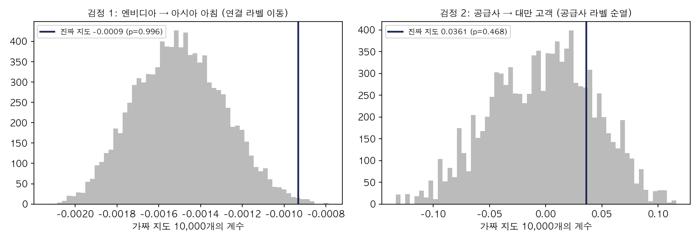
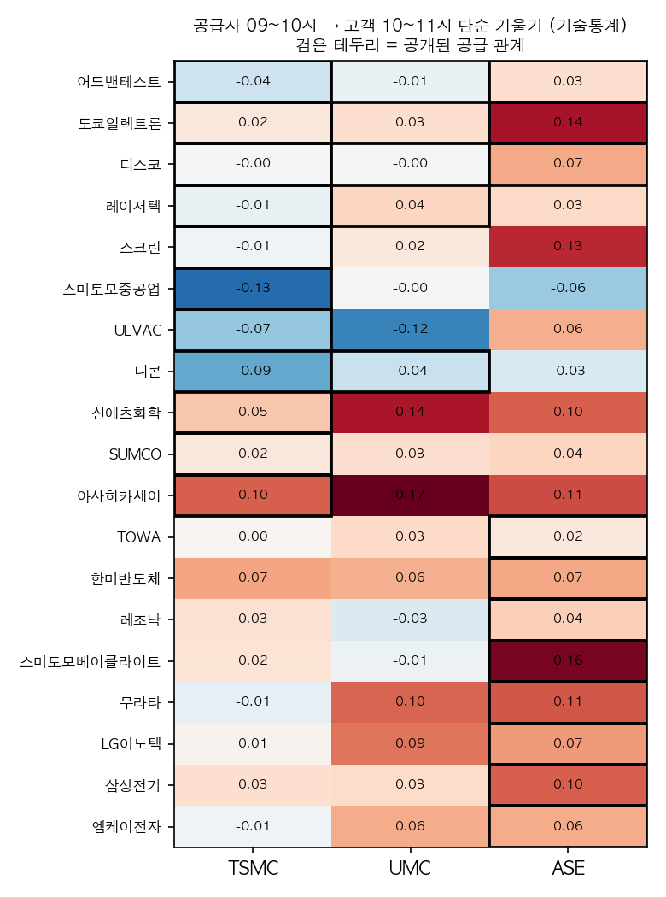

# 가설 3 결과: AI 공급망 지도를 따른 가격 전파 (11/18)

관련 파일: 사전 고정 [가설3_공급망지도_사전고정.md](가설3_공급망지도_사전고정.md), 코드 `research/network.py`, 지도 `research/map/nodes.csv`, `research/map/edges.csv`(근거 링크 포함), 결과 `results/h3_network_tests.csv`, `results/h3_test1_by_firm.csv`, `results/h3_heatmap.csv`, 그림 `figs/h3_permutation.png`, `figs/h3_heatmap.png`

## 결과

사전 고정 그대로, 대만은 가권으로 시장 조정했습니다.

| 검정 | 계수 | 날짜 군집 p | 순열 p | BH q | 판정 |
| --- | ---: | ---: | ---: | ---: | --- |
| 1. 엔비디아 밤 → 아시아 첫 1시간 (연결 회사 추가 반응 c) | −0.0009 | 0.008 | 0.996 (가짜 지도 1만 개) | 0.996 | 효과 없음, 방향 반대 |
| 2. 한국, 일본 공급사 09~10시 → 대만 고객 10~11시 (β) | +0.0361 | 0.25 | 0.25 (가능한 가짜 지도 4개 전부) | 0.50 | 효과 없음 |

- 검정 1은 23개 회사, 775일, 16,554개 관측, 검정 2는 TSMC, UMC, ASE의 667일입니다.
- 사전 기준(순열 p < 0.10이고 계수 양수)은 둘 다 넘지 못했습니다.

## 보조 분석

| 검정 | 대만 시장 조정 | 귀무분포 | 계수 | 날짜 군집 p | 순열 p |
| --- | --- | --- | ---: | ---: | ---: |
| 2 | 가권 | 업종 안 공급사 라벨 순열 1만 | +0.0361 | 0.25 | 0.47 |
| 1 | 대만 비교 바스켓 | 업종 안 연결 라벨 이동 1만 | −0.0003 | 0.35 | 0.44 |
| 2 | 대만 비교 바스켓 | 재배선(4개) | +0.0007 | 0.99 | 0.75 |
| 2 | 대만 비교 바스켓 | 공급사 라벨 순열 1만 | +0.0007 | 0.99 | 0.98 |

대만 비교 바스켓은 미디어텍, 폭스콘, 콴타, 위스트론, 난야 동일가중(분석 대상 회사는 제외)입니다. 모든 민감도 분석에서 결론이 같았습니다.

## 해석

- 공개된 공급망 관계를 따라 추가로 반응하는 모습은 보이지 않았습니다.
- 히트맵(`figs/h3_heatmap.png`)은 갭, 공개일, 고정효과를 반영하지 않은 단순 쌍별 기울기라 검정이 아니라 참고 그림입니다. 공개된 관계(테두리 칸)가 다른 칸보다 뚜렷하게 진하지 않았고, 색은 공급사(행)마다 달랐습니다.
- 결과는 야후 60분봉의 첫 봉 시가와 마지막 봉 종가 기준입니다. 첫 봉 시가는 일봉 시가와 상관이 0.9997 이상이지만, 마지막 봉 종가는 일봉 종가와 정확히 같지 않은 날이 있었습니다.

### 사전 계획 밖에서 본 패턴

- 처음 실행에서 검정 1의 b(연결이 없는 회사의 엔비디아 반응)가 −0.0022로 뚜렷했습니다. 엔비디아가 1표준편차 움직이면 다음 날 시장 조정 첫 1시간이 −0.22%p 움직이는 셈이라, 엔비디아 밤 움직임이 아시아 아침에 되돌려지는 것처럼 보였습니다. 연결 회사(b+c)는 −0.0031이었습니다. 데이터를 고친 뒤에는 b −0.0013, b+c −0.0022였습니다.
- 그런데 대만 회사를 가권 대신 대만 비교 바스켓으로 조정하면 b가 −0.0001로 사라졌습니다.
- 개별 회사의 되돌림이라기보다, TSMC 비중이 큰 가권의 첫 1시간 움직임을 빼는 과정에서 생겼을 가능성이 큽니다. 그래서 새 가설로 키우지 않았습니다.

## 고친 점

1. 검정 2 결측 처리: 휴장 등으로 값이 없는 공급사가 분모에는 들어가 0 수익률처럼 계산됐습니다. 그날 값이 있는 공급사만 분자와 분모에 넣도록 고쳤습니다(관측 2,121 → 2,001).
2. 검정 2 재배선: 업종 안 연결 수를 유지하면 만들 수 있는 가짜 지도가 4개뿐이었습니다. 1만 번 중복으로 뽑는 대신 4개를 한 번씩 세도록 바꿨습니다. 실제 지도가 4개 중 가장 커도 p의 최솟값이 0.25라, 이 설계로는 10% 기준을 넘을 수 없습니다. 그래서 업종 안 공급사 라벨 순열을 민감도로 추가했습니다.
3. 처음 나온 순열 p 0.0001: 관측 계수와 가짜 계수를 서로 다른 방식으로 계산해, 실제와 같은 지도도 소수점 차이로 "더 작다"고 세어진 버그였습니다. 같은 계산식으로 통일했습니다.
4. 엔비디아 표준화: 전체 파일 대신 분석 표본(11/11까지)의 표준편차를 씁니다. 단위만 바뀌고 p값은 같습니다.
5. 업종 이름: 아사히카세이(노광 소재)가 있는 업종 이름을 "웨이퍼소재"에서 "전공정소재"로 바로잡았습니다. 구성 회사가 같아 결과는 그대로입니다.
6. 지도 근거: `research/map/edges.csv`에 연결마다 근거 링크와 공개일 추정 여부를 넣었습니다.
7. 야후 데이터 오류(11/18, 가설 4 분석 중 발견): TOPIX ETF(`1306.T`) 60분봉이 2026-03-30 1:10 분할 전 가격을 수정하지 않아, 그날 일본 회사 전부의 시장 조정 갭이 약 +230%로 들어갔습니다. `yahoo/fix_yahoo.py`로 고친 뒤 다시 돌렸고, 검정 1 순열 p는 0.90에서 0.996으로, 바스켓 민감도 p는 0.38에서 0.44로 바뀌었습니다. 검정 2는 변화가 없었고 결론은 같았습니다.

## 결론

- 공개된 AI 공급망 지도는 이 데이터(2023-11 ~ 2026-11, 야후 60분봉, 선형 모형)에서 시간 순서에 따른 가격 전파를 추가로 설명하지 못했습니다.
- 엔비디아 이후 아시아 첫 1시간의 음의 반응은 시장 조정 방식에서 생긴 착시일 가능성이 있어 거래 신호로 쓰지 않습니다.
