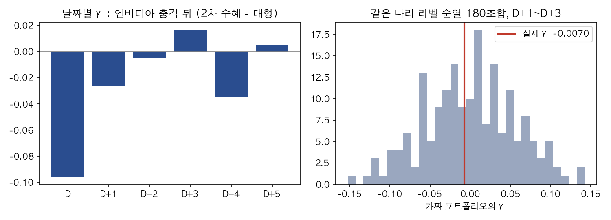

# 가설 4 결과: AI 2차 수혜 기업의 지연 반응 (11/18)

관련 파일: 사전 고정 [가설4_2차수혜_사전고정.md](가설4_2차수혜_사전고정.md), 코드 `research/second_tier_delay.py`, `research/second_tier_posthoc.py`, 결과 `results/h4_second_tier_tests.csv`, `results/h4_gamma_path.csv`, `results/h4_label_perm_gammas.csv`, `results/h4_posthoc_large_to_second.csv`, 그림 `figs/h4_second_tier.png`

## 결과

| 검정 | γ | 귀무가설을 강제한 블록 부트스트랩 단측 p | 판정 |
| --- | ---: | ---: | --- |
| 엔비디아 고유 충격 → (2차 수혜 − 대형) D+1~D+3 | −0.0070 | 0.54 | 미달 (기준 p < 0.05, γ > 0) |

- 표본은 미국 신호일 2024-06-28 ~ 2026-11-05 중 세 나라가 모두 계산된 584일입니다.
- 엔비디아 고유 충격 1표준편차(1.9%)당 3일 차이는 약 −0.01%p로 사실상 0이었습니다.

## 보조 분석

| 분석 | γ | 단측 p |
| --- | ---: | ---: |
| 블록 5일 / 20일 | −0.0070 | 0.54 / 0.53 |
| 시장모형 잔차 | −0.018 | 0.60 |
| 한국만 / 일본만 / 대만만 | +0.186 / −0.164 / −0.044 | 0.08 / 0.89 / 0.69 |
| D 당일 | −0.096 | 0.99 (계수는 반대 방향) |
| D+1 / D+1~D+5 | −0.026 / −0.016 | 0.75 / 0.55 |
| 같은 나라 라벨 순열 180조합 | −0.0070 | 0.56 |

### 결과를 본 뒤 한 분석: 신호를 아시아 대형 AI주로 바꾼 경우

원래 보고 싶었던 것은 엔비디아가 아니라 "아시아 AI 대형주 → 2차 수혜 기업" 관계였습니다. 사전 고정에서 신호를 엔비디아로 정했기 때문에, 이 분석은 본선 결과를 본 뒤 한 것이고 판정을 바꾸지 않습니다. 정의는 실행 전에 먼저 적어 두었습니다.

- 나라별 현지 거래일 d(2024-07-01 ~ 2026-11-11) 중 세 나라가 모두 연 날만 씁니다.
- 종목별 시장 조정 수익률 = 종목 − 자국 지수(β 1). 지수는 본선 시장모형과 같습니다.
- 신호 L_d는 대형 포트폴리오의 시장 조정 수익률, 통제 S_d는 같은 날 2차 수혜 포트폴리오의 시장 조정 수익률입니다.
- 결과 Y는 2차 수혜 포트폴리오의 d+1 ~ d+3 시장 조정 누적 수익률입니다.
- 나라별 회귀 Y = α + γ·L_d + δ·S_d + e에서 세 나라 γ 평균을 봅니다. 양수면 대형주가 오른 뒤 2차 수혜 기업이 따라 오른다는 뜻입니다.
- 제한모형(γ = 0) 잔차를 세 나라 같은 날짜로 묶어 10일 원형 블록으로 1만 회 다시 뽑아 단측 p를 구합니다.
- 대만 대형주는 TSMC 하나라, 가권으로 조정하면 자기 자신을 일부 빼는 한계가 있습니다.

| 나라 | γ | 대형 신호 하루 표준편차 |
| --- | ---: | ---: |
| 한국 | −0.069 | 1.7% |
| 일본 | +0.020 | 2.9% |
| 대만 | +0.139 | 0.9% |
| 평균 | +0.030 | 단측 p 0.34 |

세 나라가 모두 연 501일 기준입니다. 대형 AI주가 시장보다 더 오른 날 뒤 3일 동안 2차 수혜 기업이 따라 오르는 모습은 뚜렷하지 않았고, 나라마다 방향도 달랐습니다.

## 해석

- D 당일에는 대형주가 2차 수혜 기업보다 엔비디아 충격을 더 크게 반영하는 방향의 계수가 나왔습니다(γ_D = −0.096, 충격 1표준편차당 약 0.18%p 차이). 사전에 예상한 "대형주가 먼저"와 같은 방향입니다.
- 그러나 그 뒤 며칠 동안 2차 수혜 기업이 따라잡지 않았습니다. 덜 반응한 이유는 지연보다 엔비디아에 대한 노출 차이일 가능성이 있습니다.
- 한국만 따로 보면 p 0.08로 양의 방향이었지만, 사전에 정한 판정이 아니고 회사가 2개뿐이라 새 가설로 키우지 않았습니다.

## 고친 점

- 사후 분석 첫 실행에서 일본 대형 신호의 하루 표준편차가 14.7%로 나와 원본을 확인했습니다.
  - TOPIX ETF(`1306.T`) 일봉이 2026-03-30, 31 두 날만 1/10로 기록돼 있었습니다. 1:10 분할은 운용사 공지로 확인했습니다.
  - GST 일봉도 2024-06-17에 전날 대비 약 1/2로 끊겨 있었습니다. 분할이나 무상증자로 추정했지만 공식 자료는 확인하지 못해, 가격이 이어지도록만 보정했습니다.
- `yahoo/fix_yahoo.py`로 고치고 원본은 `_orig` 파일로 남긴 뒤 전부 다시 돌렸습니다.
- 본선은 지수를 쓰지 않아 γ와 p가 그대로였고, 시장모형 민감도만 −0.0068에서 −0.018로 바뀌었습니다. 결론은 같았습니다.

## 결론

- 당시 마지막으로 정한 네 번째 가설도 사전 기준을 넘지 못했습니다. 이때는 사전에 정한 대로 종목, 기간, 시간 단위를 더 바꾸지 않기로 했습니다.
- 네 가설을 거치며 일관되게, 이 데이터(야후 일봉과 60분봉, 2023~2026)에서는 엔비디아와 AI 관련 충격이 아시아 가격에 당일 안에 반영됐을 가능성이 있고, 이후 예측할 수 있는 전파는 확인되지 않았습니다.
