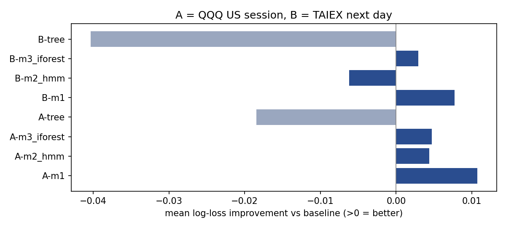

# 가설 5 결과: 아시아 AI 종목 정보로 다음 세션의 큰 움직임 예측 (11/19)

관련 파일: 사전 고정 [가설5_변동성ML_사전고정.md](가설5_변동성ML_사전고정.md), 코드 `research/vol_ml.py`, `research/vol_ml_posthoc.py`, 결과 `results/h5_vol_ml_tests.csv`, `results/h5_vol_ml_baseline.csv`, `results/h5_vol_ml_preds.csv`, `results/h5p_*.csv`, 그림 `figs/h5_vol_ml.png`

가설 4 결과를 본 뒤 추가한 탐색적 분석입니다.

## 결과

학습에 쓰지 않은 날의 log-loss 개선으로 6개 검정을 판정했습니다.

| 대상 | 방법 | 평균 Δlog-loss | 단측 p | BH q | 판정 |
| --- | --- | ---: | ---: | ---: | --- |
| A. QQQ 미국 정규장 | 1. 당일 등락 특징 | +0.0107 | 0.079 | 0.28 | 미달 |
| A | 2. HMM 국면 | +0.0044 | 0.19 | 0.28 | 미달 |
| A | 3. 이상치 점수 | +0.0047 | 0.17 | 0.28 | 미달 |
| B. 대만 다음 날 | 1. 당일 등락 특징 | +0.0077 | 0.14 | 0.28 | 미달 |
| B | 2. HMM 국면 | −0.0062 | 0.92 | 0.92 | 미달 |
| B | 3. 이상치 점수 | +0.0029 | 0.29 | 0.35 | 미달 |

- 시험 구간은 A 490일(2024-07-09 ~ 2026-11-11), B 519일(2024-06-17 ~ 2026-11-10)이고, 큰 움직임 비율은 31%, 33%였습니다.
- 사전 기준(평균 Δ > 0이고 BH q < 0.10)은 6개 모두 넘지 못했습니다.
- 보조로 본 결정나무(방법 1 특징)는 A −0.018, B −0.040으로 기본 모델보다 나빴습니다.

## 보조 분석

### 기본 모델이 약했던 이유

| 대상 | 기본 모델 log-loss | 항상 30% 예측 | 기본 모델 AUC |
| --- | ---: | ---: | ---: |
| A | 0.629 | 0.621 | 0.41 |
| B | 0.642 | 0.636 | 0.42 |

기본 모델(대상의 과거 변동성)이 고정 30% 예측보다도 못했습니다. 코드를 다시 실행해 같은 결과가 나오는 것을 확인했고, 두 요인이 함께 작용한 것으로 추정합니다.

1. 라벨의 정의: 라벨이 "직전 60일의 70번째 백분위수보다 큰가"라서 최근 변동성 수준이 이미 기준값에 들어가 있습니다(최근 20일 평균과 기준값의 상관 0.78). 그래서 과거 변동성과 라벨의 관계가 거의 없었습니다(전체 AUC 0.51). 학습 구간에서는 약한 음의 관계(0.46), 시험 구간에서는 양의 관계(0.58)로 바뀌어 기본 모델이 거꾸로 배웠습니다.
2. 약한 기본 모델: 라벨 기준값(임계값)을 계산해 놓고도 기본 특징에 직접 넣지 않았습니다. 최근 수준과 기준값의 차이를 넣었다면 기본 모델이 더 강해졌을 가능성이 있습니다.

결국 이 설계는 최근 수준을 넘는 변동성 증가를 맞히는 문제였고, 상대 기준 라벨 때문에 큰 날 뒤에 큰 날이 이어지는 변동성 군집 효과가 약해졌을 수 있습니다. 고정 30%와의 비교는 참고용이며, 더 알맞은 비교 기준은 워크포워드 학습 구간마다의 실제 큰 움직임 비율입니다. 방법 1은 A에서 고정 30%보다 조금 나았지만(0.618 vs 0.621) 기준을 넘지 못했고, 결과를 본 뒤 라벨이나 기본 모델은 바꾸지 않았습니다. 방법 모델들이 약한 기본 모델조차 유의하게 넘지 못했으므로 판정은 바뀌지 않습니다.

### 결과를 본 뒤 만든 매매 규칙

방법 1 확률이 0.30 미만인 날만 QQQ를 시가에 사서 종가에 파는 규칙을 만들어 봤습니다. 490일 예측값은 모델 입장에서는 학습에 쓰지 않은 날이지만, 규칙(임계값, 매수, 현금 대기)은 같은 490일을 보고 정했기 때문에 독립적인 검증이 아닙니다.

- 겉보기 성과: 매일 보유는 샤프 0.01, 최대 낙폭 −20%, 규칙은 샤프 1.02, 최대 낙폭 −6%였습니다.
- 규칙을 고정했을 때 p는 무작위 같은 일수 0.022, 원형 이동 0.037이었습니다.

추가 점검(`research/vol_ml_posthoc.py`) 결과는 이랬습니다.

| 점검 | 결과 | 뜻 |
| --- | --- | --- |
| 보유일 vs 쉰 날 변동성 | 연 19.1% vs 17.1% | 조용한 날을 고르지 못했습니다. 쉰 날이 오히려 덜 출렁였습니다 |
| 보유일 vs 쉰 날 평균 수익률 | +11.3bp vs −9.9bp | 겉보기 성과는 두 집단의 평균 수익률 차이에서 나왔습니다. 큰 움직임 예측에는 방향 정보가 없어 우연일 가능성이 큽니다 |
| 하락일, 상승일을 쉰 비율 | 54% vs 52% | 하락일을 골라 피하는 힘도 거의 없었습니다 |
| 임계값 0.25 / 0.30 / 0.35 / 0.40 | 샤프 −0.07 / 1.02 / 0.47 / 0.36 | 0.30에서만 튀어 과적합 가능성이 큽니다 |
| 왕복 거래비용 3bp(추정) | 샤프 1.02 → 0.75 | |
| reality check: 아시아 특징을 200번 원형 이동하고 모델 4개 × 임계값 4개 중 최고 샤프 비교 | 실제 1.02, 재배열 표본 중앙값 0.98, 상위 5% 1.52, p 0.46 | 고르는 과정까지 반영하면 우연과 구분되지 않습니다 |

이 규칙은 발견된 신호라기보다 같은 표본을 보고 고른 규칙일 가능성이 큽니다. 11/19에 고정한 규칙은 주문 과정 점검에만 썼습니다. MNQ와 QQQ는 상관이 0.99지만 개장 스프레드, 선물 베이시스, 청산 시각이 달라 같은 전략으로 볼 수 없습니다.

## 해석

- 고정한 13종목, 상대 변동성 라벨, 세 ML 특징(당일 등락 특징, HMM 국면, 이상치)과 이 워크포워드 설계에서는 과거 변동성 모델 대비 추가 예측력을 확인하지 못했습니다.
- 변동성 예측 자체가 불가능하다는 뜻은 아닙니다. 절대 변동성 라벨이나 더 강한 기본 모델에서는 결과가 다를 수 있지만, 이번에는 결과를 본 뒤 바꾸지 않았습니다.
- 한계: Isolation Forest 입력에서 결측 종목 수익률을 0으로 채워, 실제 0% 수익률과 결측을 구분하지 못합니다. 13종목 목록은 2026년에 정했습니다.

## 결론

이 분석까지 다섯 분석이 모두 사전 기준을 넘지 못했습니다.
