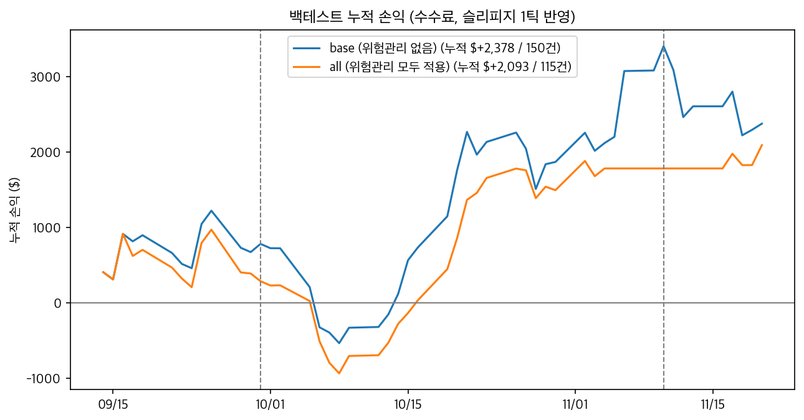
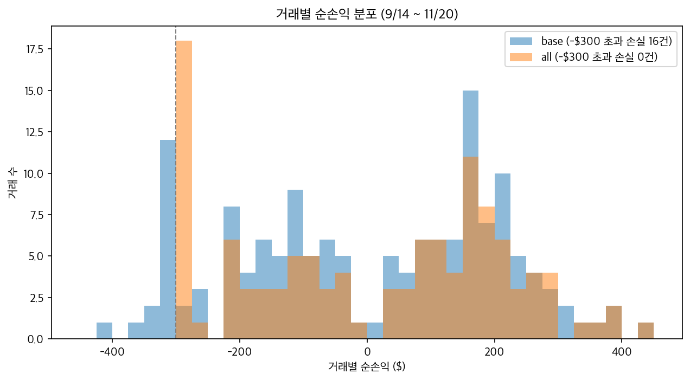
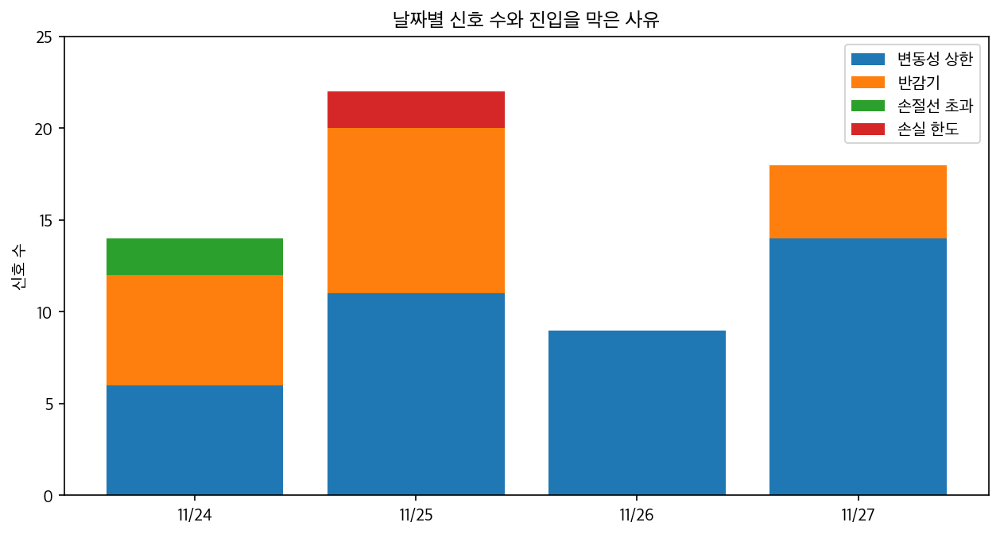

# Week 06. 전략 + 위험관리: MNQ-MGC 스프레드에 손실 제한 규칙 더하기

## 수행 내용

4주차 MNQ-MGC 가격비율 평균회귀 전략에 위험관리 규칙 다섯 가지와 레그별 비상 스톱을 더했습니다. 같은 조건의 백테스트에서 금 하락 구간 최대 낙폭은 $1,183에서 $151로 줄었지만, 4주차 기간 순손익도 $2,411에서 $1,395로 줄어 미리 정한 판정 기준 두 개 중 하나만 통과했습니다.

- 상품: Micro E-mini Nasdaq-100 202612 (`MNQZ26`), Micro Gold 202612 (`MGCZ26`), CME
- 전략: 4주차와 같은 1분봉 가격비율 z-score 평균회귀, 15:00 ~ 17:55
- 위험관리: 반감기 필터, 실시간 손절, 변동성 상한, 하루 한도와 연속 손실 중단, 3거래일 누적 한도, 레그별 비상 스톱
- 실행 환경: 모의계좌 주문
- 실행일: 2026-11-24 ~ 11-27, 손절 작동 테스트 11/27
- 실행 결과: 11/24 ~ 11/26 진입 0회, 신호 45건 모두 규칙으로 차단 (규칙이 없었다면 7회 진입, −$105)

## 1. 과제 요약

- 전략 요약: [3-2](#3-2-전략-근거)
- 위험관리 규칙과 값을 정한 이유: [3-3](#3-3-매매-규칙)
- 적용 전후 비교: 9/14 ~ 11/20 같은 데이터, 같은 비용으로 비교, [6-3](#6-3-가설별-결과)
- 손절, 부분 청산 작동 기록: [7절](#7-실행-결과)

## 2. 실행 방법

```bash
# 저장소 루트에서 실행
# 패키지 설치 후 .env에 API 키 입력
python3 -m pip install -r requirements.txt
cp .env.example .env

# 과거 1분봉 저장
python3 -m week06.fetch_data

# 백테스트: 위험관리 적용 전후 비교
python3 -m week06.backtest

# 모의계좌 주문, 14:55쯤 시작
python3 -m week06.live
```

## 3. 전략과 매매 계획

### 3-1. 대상 상품

| 레그 | 종목 | 1틱 | 가격 1.0당 |
| --- | --- | --- | --- |
| 1 | `MNQZ26` 마이크로 나스닥100 | 0.25 = $0.50 | $2 |
| 2 | `MGCZ26` 마이크로 금 | 0.10 = $1 | $10 |

- 계약 수: MNQ 2 : MGC 3 (4주차와 같음)
- 월물: 금 2월물(`MGCG27`)은 15 ~ 18시 거래량이 12월물의 약 1/27이라 12월물 유지

### 3-2. 전략 근거

**4주차 전략**

- 스프레드 = ln(MNQ) − ln(MGC). 최근 60분 평균에서 표준편차 2배 이상 벗어나면 반대로 진입
- 익절 z 1.0, z 손절 3.0, 금액 손절 $300, 시간 손절 45분, 17:55 정리, 하루 4회, 하루 손실 $600

**4주차에서 남은 위험**

| 문제 | 근거 | 대응 |
| --- | --- | --- |
| 1분 종가로 손절해 $300보다 더 잃음 | 150건 중 16건, 최악 −$403 | 실시간 손절 |
| 금 급락 구간에서 되돌림이 안 일어남 | 11/10 ~ 11/20 −$706 | 반감기 필터, 변동성 상한 |
| 프로그램이 멈추면 손절할 수단이 없음 | 손절을 모두 프로그램이 판단 | 비상 스톱 |
| 나쁜 날이 이어져도 하루 한도뿐 | 연속 손실 최대 7회 | 연속 손실 중단, 3거래일 한도 |

**참고 연구**

- Kaminski & Lo (2014): 손절은 추세가 이어질 때 도움, 되돌아오는 시장에서는 손해. 추세가 강한 날을 나눠 확인한 근거
- Gatev et al. (2006): 페어 트레이딩 수익은 되돌림 속도에 좌우. 반감기 필터의 근거
- Moreira & Muir (2017): 변동성이 클 때 노출을 줄이면 큰 손실이 줄어듦. 변동성 상한의 근거

다만 변동성 상한은 변동성이 높은 시기가 이어지면 거래 자체가 거의 없어진다는 한계가 있습니다.

### 3-3. 매매 규칙

| # | 규칙 | 값 | 값을 정한 이유 |
| --- | --- | --- | --- |
| R1 | 반감기 필터: 최근 120분 스프레드의 되돌림 반감기가 45분보다 길면 진입 안 함 | 120분, 45분 | 시간 손절이 45분이라 그 안에 절반도 안 돌아오면 익절이 어려움 |
| R2 | 실시간 손절: 체결가마다 두 레그 합산 손익 확인, −$280이면 즉시 청산 | $280 | 슬리피지가 붙어도 실제 손실을 $300 안팎으로 막으려고 $20 앞에서 판단 |
| R3 | 변동성 상한: 직전 5일 변동성과 두 레그 상관으로 계산한 45분 예상 변동액이 $300 넘으면 진입 안 함 | 5일, $300 | 보통 움직임(1σ)만으로 손절선에 닿는 날은 쉼 |
| R4 | 하루 한도: 보유 중 손익 포함 −$600이면 즉시 청산하고 종료. 3연속 손실이어도 종료 | $600, 3회 | 4주차는 청산된 손익만 봐서 보유 중에 한도를 넘을 수 있었음 |
| R5 | 3거래일 한도: 최근 3일 합 −$1,200 이하면 다음 날 쉼 | $1,200 | 하루 한도 2일치 |
| 비상 | 레그별 STOP-M: 그 레그 혼자 $600 잃는 가격에 진입 직후 주문 | MNQ 150포인트, MGC 20.0 | 프로그램이 멈춘 경우만 대비. 평소에는 R2가 먼저 작동 |

- 진입에 실패하거나, 설정한 손절 한도보다 $20 넘게 손실이 발생하거나, 비상 스톱이 체결되면 그날 신규 진입을 멈춥니다.
- 시작할 때 전날 시장 분포 변화(PSI)가 0.25를 넘으면 경고만 남깁니다([6-4](#6-4-결과를-본-뒤-만든-매매-규칙)).
### 3-4. 주문 처리

4주차 주문 처리를 그대로 쓰고 아래만 더했습니다.

- 시장가 청산 전에 비상 스톱을 먼저 취소하고 미체결 0건을 확인합니다. 스톱이 남아 있으면 나중에 체결돼 반대 포지션이 생기기 때문입니다.
- 비상 스톱이 체결되면 남은 레그만 실제 잔고 기준으로 정리합니다.
- 11/24에 금 STOP-M을 미리 접수, 취소해 보고 미체결 0건을 확인했습니다.

## 4. 사용 API와 구조

### 4-1. 사용 API

| 구분 | API | 사용 방식 |
| --- | --- | --- |
| 시세 | `overseas/chart-minute` | 시작 시 과거 1분봉(변동성, PSI, z 계산), 재접속 뒤 누락분 복구 |
| | WebSocket `FA` | 두 종목 체결 수신, 실시간 손절 판단 |
| 주문 | `overseas/order` | 시장가 진입, 청산. STOP-M 주문(`glb_ord_tp_cd` 3, `stop_pric`)과 취소(`qt_div_cd` 3) |
| | WebSocket `O1`, `overseas/order-history` | 체결 확인, 미체결 확인 |
| 계좌 | `overseas/deposit`, `overseas/open-interest` | 시작과 종료 시 예탁자산, 포지션 확인 |

### 4-2. 구조

```text
week06/
  config.json     전략, 위험관리 숫자, 비교 버전
  risk.py         반감기, 변동성, 예상 변동액, PSI (백테스트와 실행 공통)
  backtest.py     버전별 백테스트와 판정
  broker.py       STOP-M 주문, 취소
  live.py         4주차 실행 코드에 위험관리 추가
  fetch_data.py   과거 1분봉 수집
  plots.ipynb     결과 그래프
  stop_test/      손절 작동 테스트 설정
  results/        백테스트 결과, 실행 로그, 그래프
```

## 5. 실행 환경

- 실행 방식: 모의계좌 주문, WebSocket 실시간 시세
- 실행 시간: 15:00 ~ 17:57
- 실행 기록: `results/live_*.log`, `results/events_*.jsonl`, 손절 테스트는 `results/stop_test_*/`

## 6. 가설 검증

### 6-1. 데이터 수집과 점검

- 기간: 9/14 ~ 11/20, 50거래일 (4주차 파일과 새로 받은 파일을 합침)
- 원본 시세: 저장소 밖에 보관

### 6-2. 검증 방법

- 비교 버전: base, 규칙을 하나씩 적용한 5개 버전, 규칙을 모두 적용한 all
- 비용: 수수료 계약당 편도 $2, 슬리피지 1틱
- 체결 가정: 1분봉 종가로 판단하고 다음 분 시가에 체결. 실시간 손절은 1분 안의 가장 불리한 가격으로 근사
- 판정 기준(백테스트 전 고정)
  - 금 하락 구간(11/10 ~ 11/20) 최대 낙폭 30% 이상 감소
  - 4주차 기간(9/30 ~ 11/9) 순손익 감소가 30% 이내
- 독립 확인: 4주차 설정을 고를 때 안 쓴 9/14 ~ 9/29

### 6-3. 가설별 결과

**적용 전후 비교 (base / all)**

| 구간 | 거래 | 순손익 | 최대 낙폭 | 최악 거래 | $300 초과 손실 |
| --- | ---: | ---: | ---: | ---: | ---: |
| 전체 9/14 ~ 11/20 | 150 / 115 | +$2,378 / +$2,093 | $1,759 / $1,908 | −$403 / −$284 | 16 / **0** |
| 독립 확인 9/14 ~ 9/29 | 35 / 31 | +$673 / +$389 | $550 / $709 | −$323 / −$284 | 2 / 0 |
| 4주차 기간 9/30 ~ 11/9 | 91 / 76 | +$2,411 / +$1,395 | $1,318 / $1,326 | −$403 / −$284 | 8 / 0 |
| 금 하락 11/10 ~ 11/20 | 24 / 8 | −$706 / **+$309** | $1,183 / **$151** | −$375 / −$284 | 6 / 0 |





**규칙별 판정**

| # | 금 하락 낙폭 | 4주차 기간 순손익 | 결과 |
| --- | --- | --- | --- |
| R1 반감기 | $941 (미달) | +$2,895 (통과) | 미달 |
| R2 실시간 손절 | $962 (미달) | +$2,055 (통과) | 미달 |
| R3 변동성 상한 | $580 (통과) | +$1,448 (미달) | 미달 |
| R4 하루 한도 | $1,183 (미달) | +$2,477 (통과) | 미달 |
| R5 3거래일 한도 | 작동 안 함 | 작동 안 함 | 미달 |
| **all ✅** | **$151 (통과)** | **+$1,395 (미달)** | **하나만 통과** |

base는 금 하락 낙폭 $1,183, 4주차 기간 순손익 +$2,411입니다.

- $300 넘는 손실이 없어졌고, 손익 하위 25%인 날의 평균 손익이 $124 나아졌습니다(p 0.03).
- p는 날짜를 5일 블록으로 재표집해, 개선이 0 이하로 나오는 비율로 계산했습니다.
- 대신 전체 기간 최대 낙폭은 $149 늘었습니다.

**실시간 손절: 추세가 강한 날 / 나머지**

| 날 | 일수 | R2 − base |
| --- | ---: | ---: |
| 추세가 강한 날 (상위 25%) | 13 | +$249 |
| 나머지 | 37 | −$509 |

이번 표본에서도 손절은 추세가 강한 날에만 도움이 됐습니다. 다만 최악 거래를 막아 주므로 남겼습니다.

### 6-4. 결과를 본 뒤 만든 매매 규칙

신용평가 모형의 성능 지표로 규칙을 더 점검했습니다.

| 지표 | 뜻 | 여기서 쓴 방식 |
| --- | --- | --- |
| AUC | 점수가 손실 거래를 이익 거래보다 높게 매길 확률. 0.5면 무작위 | 필터 점수가 손실 거래를 가려내는지 |
| Gini | 2 × AUC − 1. 0이면 구분 못 함 | AUC와 같은 내용 |
| KS | 손실 거래와 이익 거래의 점수 분포가 가장 크게 벌어지는 차이 | AUC 보조 |
| PSI | 기준 기간과 비교한 분포 변화. 0.25 넘으면 큰 변화로 봄 | 스프레드 1분 변화 분포가 4주차 때와 달라졌는지 |

| 후보 | 결과 | 결정 |
| --- | --- | --- |
| 반감기 필터 | AUC 0.50, Gini +0.01, KS 0.10. 개별 거래는 못 가려냄 | 유지 |
| 변동성 상한 | AUC 0.52, Gini +0.05, KS 0.09. 손실 거래를 고르는 대신 위험한 날 전체를 쉬는 규칙 | 유지 |
| PSI로 거래 쉬기 | 기준 기간 최대 0.16, 11/20 0.65 등 최근 분포가 크게 변함. 하지만 PSI 높은 날 쉬면 이익 나는 날을 쉼 | 경고로만 기록 |
| 진입 10분 뒤 손익으로 조기 청산 | AUC 0.72, Gini +0.44지만 9/14 ~ 9/29에서 −$674 | 채택 안 함 |
| 두 레그 상관 낮은 날 쉬기 | 이익 나는 날을 쉼 | 채택 안 함 |

## 7. 실행 결과

### 7-1. 모의계좌 실행

**3일 동안 신호 45건이 모두 규칙에 막혀 진입하지 않았습니다.** 같은 날짜 백테스트에서 규칙이 없었다면 7회 진입해 −$105였습니다.

| 날짜 | 시작 | 전날 PSI | 신호 | 막은 사유 | 진입 |
| --- | --- | ---: | ---: | --- | ---: |
| 11/24 | 15:24 | 0.40 | 14 | 변동성 상한 6, 반감기 6, 손절선 초과 2 | 0 |
| 11/25 | 15:11 | 0.50 | 22 | 변동성 상한 11, 반감기 9, 손실 한도 2 | 0 |
| 11/26 | 16:00 | 0.52 | 9 | 변동성 상한 9 | 0 |
| 11/27 | (작성 예정) | | | | |



- 3일 모두 PSI 경고가 떴고, 예상 변동액이 $350 ~ $375로 상한 $300을 넘어 진입하지 않았습니다.
- 같은 날짜 백테스트에서도 all은 0회로, 실행 결과와 맞습니다.
- 11/24, 11/25에 컴퓨터 인터넷이 끊긴 구간이 있었지만 포지션이 없을 때였고, 끝난 뒤 잔고와 미체결 0건을 확인했습니다.

**손절 작동 테스트 (11/27)**

진입이 없어 손절을 확인하지 못해, 같은 코드에 설정만 바꿔 한 번씩 진입시켰습니다. 기록은 본 실행과 따로 저장했습니다(`results/stop_test_*/`).

| 테스트 | 바꾼 설정 | 확인할 것 | 결과 |
| --- | --- | --- | --- |
| A. 실시간 손절 | 바로 진입, 실시간 손절 $50 | 손절 판단, 비상 스톱 취소, 미체결 0건 확인, 시장가 청산 순서 | 금 주문 거부로 한쪽만 체결, 체결된 나스닥 정리 뒤 신규 진입 중단 |
| B. 비상 스톱 | 바로 진입, 레그별 비상 스톱 $20 | STOP-M 체결 뒤 남은 레그만 정리 | 진입 시간이 지난 뒤 시작해 진입 없음 |

**테스트 A 기록 (12:47)**

| 시각 | 기록 |
| --- | --- |
| 12:47:00 | 신호 z +0.65, 스프레드 매도 진입 |
| 12:47:00 | `MNQZ26` 매도 2계약 체결(주문 1139, 26710.25) |
| 12:47:00 | `MGCZ26` 주문 거부, 재주문도 거부: "실물인수도 방지를 위해 만기일 전일부터 신규주문이 불가합니다" |
| 12:47:00 | 체결된 `MNQZ26` 매수 2계약으로 정리(주문 1140) |
| 12:47:01 | 진입 실패로 그날 신규 진입 중단 |
| 13:17:00 | 최종 확인: 포지션 없음, 미체결 0건, 예탁자산 $14 감소 |

- 계획한 실시간 손절은 확인하지 못했지만, 한쪽만 체결됐을 때 정리하고 멈추는 규칙은 실제 주문으로 작동했습니다.
- 금 12월물이 신규 주문을 받지 않아 비상 스톱은 다시 시험하지 못했습니다.

### 7-2. 화면 캡처

| 화면 | 비고 |
| --- | --- |
| (작성 예정) | |

## 8. 결과 해석과 한계

**위험관리로 금 하락 구간의 손실은 크게 줄었지만, 좋은 구간의 이익도 함께 줄었습니다.** 효과 대부분은 변동성 상한에서 나왔고, 11/24 ~ 11/26 진입이 0회였던 것도 이 규칙 때문입니다.

- **계획대로 동작한 점**: 진입 전 필터가 백테스트와 같은 사유로 신호를 막았고, 같은 날짜 백테스트 결과와 진입 횟수가 일치했습니다.
- **계획과 달랐던 점**: 3일 동안 진입이 없었고, 11/27 손절 작동 테스트에서는 금 12월물이 만기 전일 신규 주문 제한에 걸려 실시간 손절과 비상 스톱을 실제 주문으로 확인하지 못했습니다. 월물 교체 시점을 미리 확인했어야 했습니다.
- 실행 기간이 짧고 진입이 없어, 실행으로는 손익 효과를 판단할 수 없습니다.
- 금 STOP-M을 취소한 뒤 주문내역 전체 조회에서 그 주문이 빠졌습니다. 명세와 다를 수 있어 문의할 예정입니다.

## 9. 향후 계획

- 변동성 상한을 진입 금지 대신 계약 수 축소로 바꿔 보기
- z-score 대신 새 신호로 전략을 바꾸고 6주차 위험관리 코드를 붙여 쓰기
- 실행은 유선 인터넷이나 서버에서 하기
